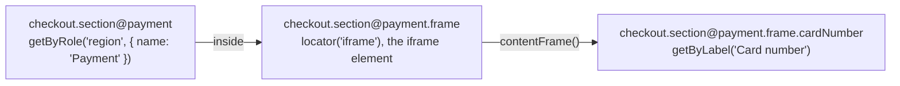

## Introduction

Playwright reaches into an iframe in two steps: a locator for the `<iframe>` element, then
[`locator.contentFrame()`](https://playwright.dev/docs/api/class-locator#locator-content-frame) to search its document
(`page.frameLocator(selector)` is the same thing in one call; see [Frames](https://playwright.dev/docs/frames)).
POMWright registers a frame as a path segment: `frameLocator(selector)` is the `<iframe>` element, and the paths below
it resolve inside the frame.



The examples on this page use a checkout page with a payment iframe:

```ts title="checkout.locators.ts"
import type { LocatorRegistry } from "pomwright";

export type Paths =
  | "checkout"
  | "checkout.section@payment"
  | "checkout.section@payment.frame"
  | "checkout.section@payment.frame.cardNumber"
  | "checkout.section@payment.frame.pay";

export function defineLocators(registry: LocatorRegistry<Paths>) {
  registry.add("checkout").locator("main");
  registry.add("checkout.section@payment").getByRole("region", { name: "Payment" });
  registry.add("checkout.section@payment.frame").frameLocator("iframe");
  registry.add("checkout.section@payment.frame.cardNumber").getByLabel("Card number");
  registry.add("checkout.section@payment.frame.pay").getByRole("button", { name: "Pay" });
}
```

## Inside the frame

A path below the frame segment resolves inside the frame's document:

```ts
import type { LocatorRegistry } from "pomwright";
import type { Paths } from "./checkout.locators";

declare const registry: LocatorRegistry<Paths>;
// ---cut---
await registry.getNestedLocator("checkout.section@payment.frame.cardNumber").fill("4242 4242 4242 4242");
// locator('main').getByRole('region', { name: 'Payment' }).locator('iframe').contentFrame().getByLabel('Card number')
```

That is exactly the chain `page.locator("main").getByRole("region", { name: "Payment" }).frameLocator("iframe")` builds.

## The frame segment itself

Resolving the frame segment's own path gives the `<iframe>` element, steps included, as Playwright's `locator(selector)`
does: `getNestedLocator("checkout.section@payment.frame")` is
`locator('main').getByRole('region', { name: 'Payment' }).locator('iframe')`. Assert on it, or call `contentFrame()` on
it to search the frame yourself. A path given to `filter({ has })` that names a frame segment is that element too.

## Telling frames apart

When a page has several iframes, first tell them apart by what surrounds them: register the frame below the segment
that distinguishes it, as `checkout.section@payment` does above. Content inside a frame cannot pick the frame: Playwright
checks the iframe elements first, and a `has` filter that enters a frame is rejected.

When the surroundings are the same, a step on the frame segment picks the element, as for any locator. The steps apply
to the `<iframe>` element, before the frame is entered:

```ts
import type { LocatorRegistry } from "pomwright";

type Paths = "widgets" | "widgets.frame@second" | "widgets.frame@second.go" | "widgets.frame@visible";
declare const registry: LocatorRegistry<Paths>;
// ---cut---
registry.add("widgets").locator(".widgets");
registry.add("widgets.frame@second").frameLocator("iframe").nth(1);
registry.add("widgets.frame@second.go").getByRole("button", { name: "Go" });
// locator('.widgets').locator('iframe').nth(1).contentFrame().getByRole('button', { name: 'Go' })

registry.add("widgets.frame@visible").frameLocator("iframe").filter({ visible: true }).nth("last");
```

A step means what it means on any `<iframe>` element: `nth`, `first` and `last` pick among the iframes in the parent
document, and `filter({ visible })`, `has` and `hasNot` test the element there. `filter({ hasText })` never matches,
because the frame's document is not part of the parent's text. Without a step, several matching iframes fail the action
with Playwright's strict mode error, naming the iframe chain:

```text
locator.click: Error: strict mode violation: locator('.widgets').locator('iframe') resolved to 3 elements:
```

A query addresses a frame segment like any other: `getLocatorSchema(path).nth("widgets.frame@second", 0)`.

## Any frame: `frameLocator()` without a selector

`frameLocator()` without a selector registers Playwright's any-frame locator, `page.frameLocator()`: the paths below it
resolve in whichever single frame holds them, the main frame included, without locating the iframe first:

```ts
import type { LocatorRegistry } from "pomwright";

declare const registry: LocatorRegistry<"anyFrame" | "anyFrame.consent">;
// ---cut---
registry.add("anyFrame").frameLocator();
registry.add("anyFrame.consent").getByRole("button", { name: "Accept" });

await registry.getNestedLocator("anyFrame.consent").click();
// frameLocator().getByRole('button', { name: 'Accept' })
```

Its rules are Playwright's. It must be the first segment of the chain that resolves, so it cannot sit below a
registered ancestor; it has no element, so it takes no steps, returns nothing to chain from `add`, cannot be resolved on
its own and cannot be a `has` reference; and Playwright fails the action when the element is found in several frames.
A frame segment with a selector may follow it. The registry's verification reports a misplaced one:

```text
Locator registry verification failed for 1 of 3 paths:
  "main.anyFrame": frameLocator() without a selector must be the first segment of the chain; "main.anyFrame" has the ancestor "main".
```

Resolved on its own: `frameLocator() without a selector does not point to a particular iframe; "anyFrame" cannot be
resolved on its own, filtered or indexed; resolve a path inside it.` "Any iframe inside this element" is a different
question, answered by `frameLocator("iframe")` below that element's segment.

`frameLocator("")` throws (`frameLocator requires a non-empty selector for "f".`). A query can install the any-frame form
on an ancestor with `replace(subPath).frameLocator()`; see [Queries](/POMWright/docs/queries/).

## Reference

- [`frameLocator()`](/POMWright/api/class-registrationbuilder/#framelocator) on the registration builder
- Playwright: [Frames](https://playwright.dev/docs/frames),
  [`locator.contentFrame()`](https://playwright.dev/docs/api/class-locator#locator-content-frame),
  [`FrameLocator`](https://playwright.dev/docs/api/class-framelocator)
