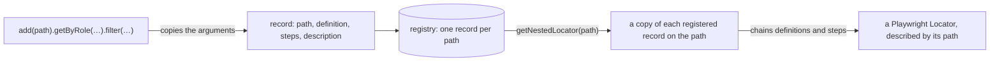

## Introduction

In Playwright you keep a locator in a variable or a field and chain from it. POMWright names it instead: every locator
has a **path**, a dot-delimited name that says where the element is, and lives in a **registry** that holds one
locator per path. A page object has its own registry; the same registry is available without a page object.

## What a path is

A path is a string of segments separated by dots, from the outside of the page inwards:

```ts
type Paths =
  | "main"
  | "main.form@login"
  | "main.form@login.input@email"
  | "main.form@login.button@submit";
```

Each path's ancestors are its prefixes: `main` and `main.form@login` are ancestors of `main.form@login.button@submit`.
A segment is any text without a dot or whitespace. Names that say what and which (`form@login`, `button@submit`) keep
paths readable in reports; the `@` is a convention, not syntax.

The union is the list of everything the registry can hold. TypeScript checks every path you pass against it, and
offers the paths as completions:

```ts
import type { LocatorRegistry } from "pomwright";

declare const registry: LocatorRegistry<"main" | "main.button@login">;
// ---cut---
registry.getNestedLocator("main.button@login");
// @ts-expect-error a path that is not in the union is a compile error
registry.getNestedLocator("main.buton@login");
```

## The rules of a path

A path is not empty, does not start or end with a dot, has no two dots in a row and contains no whitespace: none of
the 25 Unicode whitespace characters (including the no-break space) and not U+FEFF. TypeScript rejects a path literal
that breaks a rule, and POMWright checks every path again when it is registered or resolved, so a path built at
runtime is checked too:

```text
LocatorSchemaPath string cannot be empty
LocatorSchemaPath string cannot start with a dot: .main
LocatorSchemaPath string cannot end with a dot: main.
LocatorSchemaPath string cannot contain consecutive dots: main..form
LocatorSchemaPath string cannot contain whitespace chars: main.form button
LocatorSchemaPath must be a string; received 42.
```

A whitespace character that is hard to see is shown escaped: a no-break space reads `main .form`.

## Segments without a locator

Only the paths you resolve need a locator. A segment that has none is a name that groups paths, and resolution leaves
it out of the chain: `main.form` can be registered while `main` is not. Whether to register every segment is a style
choice; a project that does can have the registry check it, see
[`strictChains`](/POMWright/docs/verifying-registries/#strictchains-every-ancestor-registered).

## The registry

Every page object has its own registry and offers its methods: `this.add(path)` registers a locator, and
`getNestedLocator`, `getLocator` and `getLocatorSchema` resolve one. The registry is created with the page object and
checked right after `defineLocators()` has run.

Without a page object, `createRegistryWithAccessors(page)` creates a registry for a Playwright page and returns it with
the same methods bound to it:

```ts
import type { Page } from "@playwright/test";
import { createRegistryWithAccessors } from "pomwright";

declare const page: Page;
// ---cut---
type Paths = "main" | "main.button@save";

const { registry, add, getNestedLocator } = createRegistryWithAccessors<Paths>(page);

add("main").locator("main");
add("main.button@save").getByRole("button", { name: "Save" });
registry.verify();

await getNestedLocator("main.button@save").click();
```

A registry you create yourself is checked when you call `registry.verify()`, once everything is registered; a page
object calls it for you. See [Verifying a registry](/POMWright/docs/verifying-registries/).

## From `add` to a locator

What happens to a registration, from the call to the `Locator` an action uses:



The registry keeps copies of what you pass, and every resolution works on copies of the records, so nothing done to a
resolved locator, an options object or a query changes what is registered.

## Reference

- [`LocatorRegistry`](/POMWright/api/class-locatorregistry/) and
  [`createRegistryWithAccessors`](/POMWright/api/class-locatorregistry/#createregistrywithaccessors)
- [`LocatorSchemaPathFormat`](/POMWright/api/types/#locatorschemapathformat), the path rules as a type
- Playwright: [Locators](https://playwright.dev/docs/locators)
