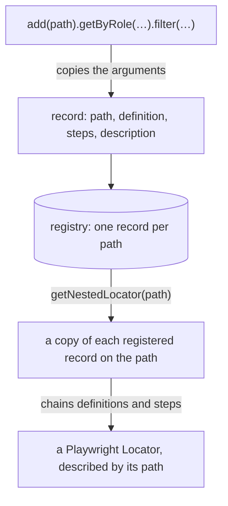

## Introduction

In Playwright you keep a locator in a variable or a field and chain from it. POMWright names it instead: every locator
has a **path**, a dot-delimited name that says where the element is, and lives in a **registry** that holds one
locator per path. A page object has its own registry; the same registry is available without a page object.

## What a path is

A path is a string of segments separated by dots, from the outside of the page inwards:

```ts
type Paths =
  | "main"
  | "main.form@login"
  | "main.form@login.input@email"
  | "main.form@login.button@login";
```

Each path's ancestors are its prefixes: `main` and `main.form@login` are ancestors of `main.form@login.button@login`.
A segment is any text without a dot or whitespace. Names that say what and which (`form@login`, `input@email`) keep
paths readable in reports; the `@` is a convention, not syntax.

The union is the list of everything the registry can hold. TypeScript checks every path you pass against it, and
offers the paths as completions:

```ts
import type { LocatorRegistry } from "pomwright";

declare const registry: LocatorRegistry<"main" | "main.button@login">;
// ---cut---
registry.getNestedLocator("main.button@login");
// @ts-expect-error a path that is not in the union is a compile error
registry.getNestedLocator("main.buton@login");
```

## The rules of a path

A path is not empty, does not start or end with a dot, has no two dots in a row and contains no whitespace: none of
the 25 Unicode whitespace characters (including the no-break space) and not U+FEFF. TypeScript rejects a path literal
that breaks a rule, and POMWright checks every path again when it is registered or resolved, so a path built at
runtime is checked too:

```text
LocatorSchemaPath string cannot be empty
LocatorSchemaPath string cannot start with a dot: .main
LocatorSchemaPath string cannot end with a dot: main.
LocatorSchemaPath string cannot contain consecutive dots: main..form
LocatorSchemaPath string cannot contain whitespace chars: main.form button
LocatorSchemaPath must be a string; received 42.
```

A whitespace character that is hard to see is shown escaped: a no-break space reads `main\u00A0.form`.

## Paths with a dynamic part

List every path in full where you can: a full path is what an error message and the report show, and a text search or
your editor's rename finds it as written. A page that repeats one element for a few known values, such as a toolbar's
buttons, can compose those paths from one `const` array with a template literal type:

```ts
import type { Page } from "@playwright/test";
import { PageObject } from "pomwright";

const actions = ["save", "publish", "discard"] as const;
type Action = (typeof actions)[number];

type Paths = "main" | "main.toolbar" | `main.toolbar.button@${Action}`;

export class EditorPage extends PageObject<Paths> {
  constructor(page: Page) {
    super(page, "https://cms.example", "/editor");
  }

  protected defineLocators(): void {
    this.add("main").locator("main");
    this.add("main.toolbar").getByRole("toolbar");
    for (const action of actions) {
      this.add(`main.toolbar.button@${action}`).getByRole("button", { name: action });
    }
  }

  async run(action: Action) {
    await this.getNestedLocator(`main.toolbar.button@${action}`).click();
  }
}
```

`Paths` is then the union of the full paths, `main.toolbar.button@save` and the others, so TypeScript checks each one
as it checks a path written out, and a query of one takes its ancestors as sub-paths
([Queries](/POMWright/docs/queries/#sub-paths)).

:::note
A composed path is not found where it is composed. An error message or the report shows `main.toolbar.button@save`,
and a text search or a rename of that path does not find `` `main.toolbar.button@${action}` ``. A search for the
prefix, `main.toolbar.button@`, still finds it, and a value changed in the array changes every path built from it.
List paths in full unless a page repeats an element for enough values to be worth it, and weigh both before you compose
them.
:::

A member with an open part, `` `main.list.item@${string}` ``, accepts any value. Only its prefix is offered as a
completion, any id compiles, an id that was never registered fails when it is resolved, and it has the same search
cost.

## Segments without a locator

Only the paths you resolve need a locator: a segment without one is a name that groups paths, and resolution leaves it
out of the chain. See [Resolving locators](/POMWright/docs/resolving-locators/#segments-without-a-locator).

## When the page changes

A path says where an element is, so when the page's structure changes, the paths follow, and a chain through the old
structure finds nothing. Each common change takes a small edit in one place, and TypeScript and the registry's check
point at anything missed. The examples start from an order section whose subscriptions sit in a Subscriptions region:

```ts
import type { Page } from "@playwright/test";
import { createRegistryWithAccessors } from "pomwright";

declare const page: Page;
// ---cut---
type Paths =
  | "main"
  | "main.section@order"
  | "main.section@order.region@subscriptions"
  | "main.section@order.region@subscriptions.region@subscription"
  | "main.section@order.region@subscriptions.region@subscription.button@edit";

const { add } = createRegistryWithAccessors<Paths>(page);

add("main").locator("main");
add("main.section@order").getByRole("region", { name: "Order" });
add("main.section@order.region@subscriptions").getByRole("region", { name: "Subscriptions" });
add("main.section@order.region@subscriptions.region@subscription").getByRole("region", { name: "Mobile subscription" });
add("main.section@order.region@subscriptions.region@subscription.button@edit").getByRole("button", { name: "Edit" });
```

### A wrapper is removed

The page drops the Subscriptions region, and the subscriptions now sit in the order section itself. Two edits bring the
chains back:

- **Delete the segment's `add(…)`, and nothing else.** A segment without a locator is left out of the chain, so every
  path below it resolves again, with its name unchanged:

  ```text
  locator('main').getByRole('region', { name: 'Order' }).getByRole('region', { name: 'Mobile subscription' }).getByRole('button', { name: 'Edit' })
  ```

  This is one line. It does not fit a registry with `strictChains: true`, whose check then reports the missing
  ancestor for every path below it:

  ```text
  "main.section@order.region@subscriptions.region@subscription": strictChains requires every ancestor to be registered; "main.section@order.region@subscriptions" is not.
  ```

- **Rename the paths below it**, so that the names describe the page again, with your editor's find and replace across
  the project:

  - find `main.section@order.region@subscriptions.`
  - replace with `main.section@order.`

  The closing dot limits the replace to the paths below the segment: the segment's own path does not contain it, and
  neither does a sibling such as `region@subscriptionsArchive`. Then remove the segment itself: its member of `Paths`
  and its `add(…)`. Anything else that still names it, a `has`, a `skip`, or an `update` or `filter` sub-path, becomes
  a compile error, to decide case by case. With regular expressions turned on, ``(["'`])main\.section@order\.region@subscriptions\.``
  replaced with `$1main.section@order.` does the same, and touches only a path in quotes.

:::note
Keep the dot. Without it, the replace also renames the segment's own path, and
`skip("main.section@order.region@subscriptions")` becomes `skip("main.section@order")`, which compiles and leaves the
wrong segment out.
:::

### A wrapper is added

A Billing region now holds the subscription. The old chains still find it, since each locator of a chain is looked for
anywhere inside the previous one, not only directly inside it. To scope them to Billing, insert the segment with two
replaces, one for the paths below the subscription and one for its own path, which is renamed too, since the
subscription still exists:

- `main.section@order.region@subscription.` with `main.section@order.region@billing.region@subscription.`
- `main.section@order.region@subscription"` with `main.section@order.region@billing.region@subscription"`

Then register `main.section@order.region@billing`. The dot and the quote keep both replaces off
`region@subscriptions`; a path in single quotes or backticks takes its own closing quote. As one regular expression,
``(["'`])main\.section@order\.region@subscription(?=[.'"`])`` replaced with
`$1main.section@order.region@billing.region@subscription` covers both, in any quote style.

### An element moves, or its locator changes

An element that moves to another section takes the same replace, from its old prefix to its new one. An element whose
role, name or test id changes needs one edit: its `add(…)`. Every chain through it, and every `has` that names it,
follows.

### One path gets a new name

Your editor's rename (F2 in VS Code) works on a single path, in two steps. Started from any use, it renames every use
of that exact path across the project, sub-path arguments included, but not its member of `Paths`; started from the
member, it renames only the member. Rename from a use, then the member: in between, TypeScript flags every use, so
nothing is missed. A rename changes whole paths only, so a change of structure, which changes the prefix of many
paths, stays a find and replace.

### A variant of the page for one test

A feature flag that drops the wrapper for one test needs no change to the registry. The test leaves the segment out of
its own query:

```ts
import type { LocatorRegistry } from "pomwright";

type Paths =
  | "main"
  | "main.section@order"
  | "main.section@order.region@subscriptions"
  | "main.section@order.region@subscriptions.region@subscription"
  | "main.section@order.region@subscriptions.region@subscription.button@edit";
declare const registry: LocatorRegistry<Paths>;
// ---cut---
const edit = registry
  .getLocatorSchema("main.section@order.region@subscriptions.region@subscription.button@edit")
  .skip("main.section@order.region@subscriptions")
  .getNestedLocator();
```

See [Queries](/POMWright/docs/queries/#leaving-an-ancestor-out-skip-and-unskip).

### What catches a missed spot

- **TypeScript.** Once `Paths` is edited, every use of an old path is a compile error, in a resolution, a `has`, or a
  sub-path of `skip`, `update` or `filter`:

  ```text
  Argument of type '"main.section@order.region@subscriptions"' is not assignable to parameter of type '"main" | "main.section@order"'.
  ```

- **The registry's check.** A `has` path that is no longer registered, or with `strictChains` an ancestor, fails the
  page object before the test body runs. A segment's `add(…)` left behind by a replace, now a second registration of
  its parent's path, fails it too:

  ```text
  OrderPage: defineLocators() failed: A locator schema with the path "main.section@order" already exists.
  ```

A path built at runtime, from a template literal, is not found by a find and replace. TypeScript still checks it when
its parts are literal types.

## The registry

Every page object has its own registry and offers its methods: `this.add(path)` registers a locator, and
`getNestedLocator`, `getLocator` and `getLocatorSchema` resolve one. The registry is created with the page object and
checked right after `defineLocators()` has run.

Without a page object, `createRegistryWithAccessors<Paths>(page)` creates a registry for a Playwright page and returns
it with the same methods bound to it:

```ts
import type { Page } from "@playwright/test";
import { createRegistryWithAccessors } from "pomwright";

declare const page: Page;
// ---cut---
type Paths = "main" | "main.button@save";

const { registry, add, getNestedLocator } = createRegistryWithAccessors<Paths>(page);

add("main").locator("main");
add("main.button@save").getByRole("button", { name: "Save" });
registry.verify();

await getNestedLocator("main.button@save").click();
```

A registry you create yourself is checked when you call `registry.verify()`, once everything is registered; a page
object calls it for you. See [Verifying a registry](/POMWright/docs/verifying-registries/).

The path union is a required type argument of both, `PageObject<Paths>` and `createRegistryWithAccessors<Paths>(page)`.
A registry created without it takes no path, and its first path says what is missing:

```text
Argument of type '"main"' is not assignable to parameter of type '"createRegistryWithAccessors needs its paths as a type argument: createRegistryWithAccessors<Paths>(page)"'.
```

`<string>` is accepted, and best avoided: it gives up every check TypeScript makes on paths (completions, the rules of a
path, paths not in the union, sub-paths), which POMWright then makes at run time only. It suits paths known only at run
time, such as locators loaded from JSON, and a gradual move from untyped code, such as 2.x.

## From `add` to a locator

What happens to a registration, from the call to the `Locator` an action uses:



The registry keeps copies of what you pass, and every resolution works on copies of the records, so nothing done to a
resolved locator, an options object or a query changes what is registered.

## Reference

- [`LocatorRegistry`](/POMWright/api/class-locatorregistry/) and
  [`createRegistryWithAccessors`](/POMWright/api/class-locatorregistry/#createregistrywithaccessors)
- [`LocatorSchemaPathFormat`](/POMWright/api/types/#locatorschemapathformat), the path rules as a type
- Playwright: [Locators](https://playwright.dev/docs/locators)
