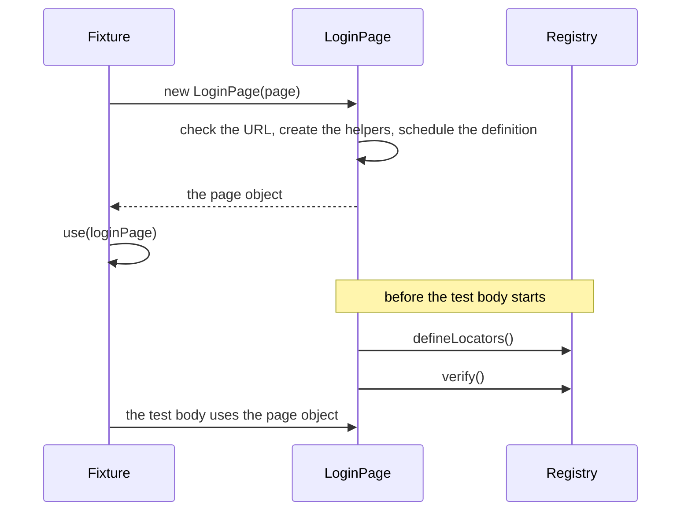

## Introduction

Playwright's [page object models](https://playwright.dev/docs/pom) guide puts the locators and actions of a page in a
class. `PageObject` is a base class for that pattern. A subclass names its paths, passes its URL to the constructor and
registers its locators in `defineLocators()`; in return it has a [registry](/POMWright/docs/locator-paths/), a
[navigation helper](/POMWright/docs/urls-and-navigation/) built from its URL, a
[session storage helper](/POMWright/docs/session-storage/) for its origin, and a check of its locators that runs right
after it is constructed.

## Anatomy

```ts title="login.page.ts"
import type { Page } from "@playwright/test";
import { PageObject, step } from "pomwright";

type Paths =
  | "main"
  | "main.form@login"
  | "main.form@login.input@email"
  | "main.form@login.input@password"
  | "main.form@login.button@login";

export class LoginPage extends PageObject<Paths> {
  constructor(page: Page) {
    super(page, "https://shop.example", "/login");
  }

  protected defineLocators(): void {
    this.add("main").locator("main");
    this.add("main.form@login").getByRole("form", { name: "Log in" });
    this.add("main.form@login.input@email").getByLabel("Email");
    this.add("main.form@login.input@password").getByLabel("Password");
    this.add("main.form@login.button@login").getByRole("button", { name: "Log in" });
  }

  @step()
  async logIn(email: string, password: string) {
    await this.getNestedLocator("main.form@login.input@email").fill(email);
    await this.getNestedLocator("main.form@login.input@password").fill(password);
    await this.getNestedLocator("main.form@login.button@login").click();
  }
}
```

- `PageObject<Paths>` takes the union of paths and, optionally, a second type argument for the URL types and the
  storage schema (`PageObjectTypeOptions`, see [URLs and navigation](/POMWright/docs/urls-and-navigation/) and
  [Session storage](/POMWright/docs/session-storage/#through-a-page-object)).
- `super(page, baseUrl, urlPath, options?)` takes the Playwright page, the origin, the page's path and the options:
  `label` (the name in step titles and error messages, the class name by default), `navOptions` (defaults for every
  navigation, see [URLs and navigation](/POMWright/docs/urls-and-navigation/#options-and-timeouts)), `sessionStorage`
  (the codecs of the session storage keys) and `locators` (`{ strictChains }`, see
  [Verifying a registry](/POMWright/docs/verifying-registries/#strictchains-every-ancestor-registered)).
- `defineLocators()` registers the locators. It is the one method every page object implements. A site's base class
  can implement it once, registering the locators every page shares before each page's own, and offer the methods that
  use them; see [Locator modules](/POMWright/docs/locator-modules/#locators-every-page-shares-in-a-base-class).
- The page object offers `add`, `getNestedLocator`, `getLocator` and `getLocatorSchema`, plus `page`, `baseUrl`,
  `urlPath`, `fullUrl`, `label`, `navigation` and `sessionStorage`; its registry is `this.locatorRegistry`.

## When `defineLocators()` runs

`PageObject` does not call `defineLocators()` from its own constructor, where the subclass has not set anything yet. It
runs once, right after the code that called `new` has finished, followed by the registry's check, or at the first
locator call on the page object if that comes earlier:



So the definition can use everything the subclass's constructor sets: its arguments, parameter properties, fields and
assignments in the constructor body:

```ts
import type { Page } from "@playwright/test";
import { PageObject } from "pomwright";

const loginLabel = { en: "Log in", nb: "Logg inn" } as const;

export class LocalizedLoginPage extends PageObject<"main" | "main.button@login"> {
  constructor(page: Page, private readonly locale: "en" | "nb") {
    super(page, "https://shop.example", "/login", { label: "LoginPage" });
  }

  protected defineLocators(): void {
    this.add("main").locator("main");
    this.add("main.button@login").getByRole("button", { name: loginLabel[this.locale] });
  }
}
```

What the definition cannot see:

- **A value assigned after an `await` that follows `new`.** The definition has run by then: pass the value to the
  constructor.
- **What is set after a field that resolves a locator.** `readonly submit = this.getNestedLocator("…")` runs the
  definition while the class is still being built: the fields below it and the constructor body have not run yet, so
  the definition reads them as `undefined`. A getter resolves when it is read and is always safe:
  `get submit() { return this.getNestedLocator("main.form@login.button@login"); }`.

## How a mistake is reported

A mistake in `defineLocators()` or found by the registry's check is reported with the page object's label, the original
error as `cause`, and the line that constructed the page object in the stack:

```text
LoginPage: defineLocators() failed: A locator schema with the path "main" already exists. …
LoginPage: Locator registry verification failed for 1 of 5 paths:
  "main.form@login": No locator schema registered for path "main.form@login.heading".
```

The page object keeps the error: every later locator call on it throws it again, and `defineLocators()` never runs a
second time. Where the page object is built decides what the test run shows:

| built in | result |
| --- | --- |
| a test-scoped or worker-scoped fixture | the test fails before its body runs |
| `beforeEach` | each test fails; its body runs until its first use of the page object |
| `beforeAll` | every test of the group fails, each body running until its first use; in a `serial` group the first test fails and the others do not run |

`new` itself does not throw for such a mistake. A test that asserts one uses the page object right after creating it,
with no `await` in between:

```ts
import { expect, type Page, test } from "@playwright/test";
import { PageObject } from "pomwright";

class BrokenPage extends PageObject<"main"> {
  constructor(page: Page) {
    super(page, "https://shop.example", "/");
  }

  protected defineLocators(): void {
    this.add("main").locator("main");
    this.add("main").locator("main"); // registered twice
  }
}

test("a broken page object reports its mistake", async ({ page }) => {
  expect(() => new BrokenPage(page).getNestedLocator("main")).toThrow(
    'BrokenPage: defineLocators() failed: A locator schema with the path "main" already exists.',
  );
});
```

## Actions after navigation

`pageActionsToPerformAfterNavigation()` returns the actions to run after `navigation.goto()` to this page and after
`navigation.expectThisPage()`, for what a page needs before a test may use it, such as a spinner going away. It is
optional; leave it out when there are none:

```ts
import { expect, type Page } from "@playwright/test";
import { PageObject } from "pomwright";

export class DashboardPage extends PageObject<"main" | "main.spinner"> {
  constructor(page: Page) {
    super(page, "https://shop.example", "/dashboard");
  }

  protected defineLocators(): void {
    this.add("main").locator("main");
    this.add("main.spinner").getByRole("progressbar");
  }

  protected pageActionsToPerformAfterNavigation() {
    return [
      async () => {
        await expect(this.getNestedLocator("main.spinner")).toBeHidden();
      },
    ];
  }
}
```

It is called each time the actions run, not when the page object is constructed, so it can read the page object's
current state. `[]` and `null` both mean no actions. `goto({ runPostNavigationActions: false })` and
`expectThisPage({ runPostNavigationActions: false })` skip them for one call. With the `noImplicitOverride` compiler
option, the method needs the `override` keyword.

## One registry per page object

Every page object has its own registry, defined once. Definitions may depend on the page object's own state, so they
are not shared between instances.

## Reference

- [`PageObject`](/POMWright/api/class-pageobject/): the constructor, the hooks and every property
- [`PageObjectOptions`](/POMWright/api/types/#pageobjectoptions), [`PageObjectTypeOptions`](/POMWright/api/types/#pageobjecttypeoptions)
- Playwright: [Page object models](https://playwright.dev/docs/pom), [Fixtures](https://playwright.dev/docs/test-fixtures)
