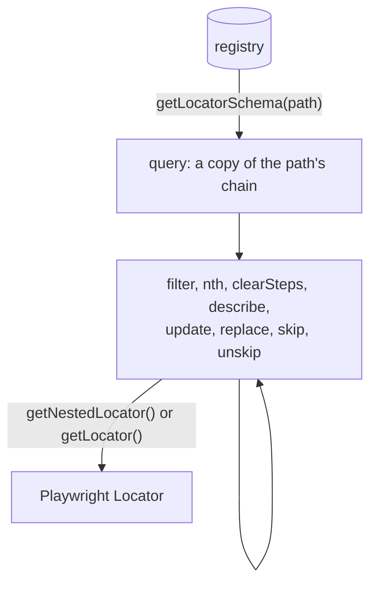

## Introduction

In Playwright, a variation of a locator is a new locator: you chain `filter` or `nth` onto it, or write another one.
POMWright's registered locators do not change, so a variation for one test is a **query**: `getLocatorSchema(path)`
returns a private copy of the path's chain, its segments with their definitions, steps and descriptions. You change
the copy and resolve it; the registry stays as it is, and the next `getLocatorSchema` starts from the registry again.



The examples on this page use this registry:

```ts title="orders.locators.ts"
import type { LocatorRegistry } from "pomwright";

export type Paths = "main" | "main.list" | "main.list.item" | "main.button@save";

export function defineLocators(registry: LocatorRegistry<Paths>) {
  registry.add("main").locator("main");
  registry.add("main.list").locator("ul").filter({ hasText: "Orders" });
  registry.add("main.list.item").locator("li").nth(0);
  registry.add("main.button@save").getByRole("button", { name: "Save", exact: true });
}
```

## Starting a query

`getLocatorSchema(path)` starts a query of a registered path; `getNestedLocator()` resolves its whole chain and
`getLocator()` the path's own locator, as the registry's methods of the same names do:

```ts
import type { LocatorRegistry } from "pomwright";
import type { Paths } from "./orders.locators";

declare const registry: LocatorRegistry<Paths>;
// ---cut---
const lastOrder = registry.getLocatorSchema("main.list.item").clearSteps().nth("last").getNestedLocator();
// locator('main').locator('ul').filter({ hasText: 'Orders' }).locator('li').last()
```

A query's methods change the query and return it, so they chain. Each `getLocatorSchema` call is a new, independent
copy. In a page object the method is `this.getLocatorSchema(path)`, typically in a method that needs a variation:

```ts
import type { Page } from "@playwright/test";
import { PageObject } from "pomwright";
import { defineLocators, type Paths } from "./orders.locators";

export class OrdersPage extends PageObject<Paths> {
  constructor(page: Page) {
    super(page, "https://shop.example", "/orders");
  }

  protected defineLocators(): void {
    defineLocators(this.locatorRegistry);
  }

  order(number: string) {
    return this.getLocatorSchema("main.list.item").clearSteps().filter({ hasText: number }).getNestedLocator();
  }
}
```

## Sub-paths

Most methods take a sub-path: the query's own path or one of its registered ancestors. Without one they work on the
query's own path. A path outside the chain, or a segment of it without a locator, throws at the call:

```text
"main.button@save" is not a valid sub-path of "main.list.item".
"main.form" is not a valid sub-path of "main.form.button@save". It is a segment of that path, but no locator schema is registered for it.
```

## Steps: `filter`, `nth`, `clearSteps`

`filter` and `nth` add a step after a segment's registered steps; `clearSteps` removes the segment's steps:

```ts
import type { LocatorRegistry } from "pomwright";
import type { Paths } from "./orders.locators";

declare const registry: LocatorRegistry<Paths>;
// ---cut---
registry.getLocatorSchema("main.list.item").filter("main.list", { hasText: "Open" }).getNestedLocator();
// locator('main').locator('ul').filter({ hasText: 'Orders' }).filter({ hasText: 'Open' }).locator('li').first()

registry.getLocatorSchema("main.list.item").nth("last").getNestedLocator();
// locator('main').locator('ul').filter({ hasText: 'Orders' }).locator('li').first().last()
```

The registered `nth(0)` stays unless cleared, so the second query still finds the first item: `clearSteps()` first
when a step should replace the registered ones.

## The description: `describe`

`describe` sets the description of the resolved locator for this query; `describe("")` removes it, so the locator
prints as its chain. See [Descriptions](/POMWright/docs/descriptions/).

## Patching a definition: `update`

`update(subPath?)` patches a segment's definition and keeps its strategy. It returns the ten locator methods; the one
of the registered strategy takes a patch in [JSON Merge Patch](https://www.rfc-editor.org/rfc/rfc7386) form, and
returns the query:

| call on `main.button@save`, registered `getByRole("button", { name: "Save", exact: true })` | result |
| --- | --- |
| `update().getByRole("link")` | `getByRole("link", { name: "Save", exact: true })`: the role replaced, the options kept |
| `update().getByRole({ name: "Cancel" })` | `getByRole("button", { name: "Cancel", exact: true })`: one option set |
| `update().getByRole({ name: null })` | `getByRole("button", { exact: true })`: one option deleted |
| `update().getByRole("button", null)` or `update().getByRole(null)` | `getByRole("button")`: every option deleted |
| `update().getByRole({ name: undefined })`, `update().getByRole("button", undefined)`, `update().getByRole()` | unchanged: `undefined` is "not given", as in Playwright |

Another strategy's method throws and says what to use instead:

```text
update("main.button@save") cannot change the strategy from "role" to "locator"; use replace("main.button@save").locator(…) instead.
```

## A new definition: `replace`

`replace(subPath?)` installs a definition of any strategy, with Playwright's own arguments: the first argument is
required and the options are Playwright's, without `null`:

```ts
import type { LocatorRegistry } from "pomwright";
import type { Paths } from "./orders.locators";

declare const registry: LocatorRegistry<Paths>;
// ---cut---
registry.getLocatorSchema("main.list.item").replace("main.list").getByRole("list", { name: "Orders" }).getNestedLocator();
// locator('main').getByRole('list', { name: 'Orders' }).filter({ hasText: 'Orders' }).locator('li').first()
```

Neither `update` nor `replace` touches the segment's steps or its description: a step is something Playwright chains
after the locator, whatever its strategy. Take them away with `clearSteps()` and `describe("")`.

## Keeping a query

A query is an object you can keep in a variable. Its methods change it, and every `getNestedLocator()` resolves it as
it is at that moment, so one query can follow an element whose state the test changes. Here an "Add to wishlist"
button reads "Remove from wishlist" once it has been clicked:

```html
<main>
  <article aria-label="Desk lamp">
    <h2>Desk lamp</h2>
    <button>Add to wishlist</button>
  </article>
</main>
```

```ts
import { expect } from "@playwright/test";
import type { LocatorRegistry } from "pomwright";

declare const registry: LocatorRegistry<"main" | "main.product@lamp" | "main.product@lamp.button@wishlist">;
// ---cut---
registry.add("main").locator("main");
registry.add("main.product@lamp").getByRole("article", { name: "Desk lamp" });
registry.add("main.product@lamp.button@wishlist").getByRole("button", { name: "Add to wishlist" });

const wishlistButton = registry.getLocatorSchema("main.product@lamp.button@wishlist");
await wishlistButton.getNestedLocator().click();

wishlistButton.update().getByRole({ name: "Remove from wishlist" });
// locator('main').getByRole('article', { name: 'Desk lamp' }).getByRole('button', { name: 'Remove from wishlist' })
await expect(wishlistButton.getNestedLocator()).toBeVisible();
await wishlistButton.getNestedLocator().click(); // the lamp leaves the wishlist again
```

One path and a query cover every state of the button, so the registry needs no path per state, such as
`main.product@lamp.button@addToWishlist` and `main.product@lamp.button@removeFromWishlist`. Register those instead if
you prefer a named path for each state.

- `update()` changes `wishlistButton` itself, so its result needs no variable. It also returns the query, so
  `wishlistButton.update().getByRole(…).getNestedLocator()` does the same in one line.
- A `Locator` resolved before the change keeps the old name, as every Playwright locator keeps what it was built from:
  resolve the query again after each change.
- The registry does not change: `registry.getNestedLocator("main.product@lamp.button@wishlist")` still finds the "Add
  to wishlist" button, and every new `getLocatorSchema` call starts from it.
- A query does not end when the registry is called again, as a registration kept in a variable does (see
  [Registering locators](/POMWright/docs/registering-locators/#registered-locators-do-not-change)): keep it as long as
  the test needs it.

## Leaving an ancestor out: `skip` and `unskip`

`skip(subPath)` leaves a registered ancestor out of the chain for this query, as if it had no locator. Nothing is
deleted: `unskip(subPath)` brings it back exactly as it was:

```ts
import type { LocatorRegistry } from "pomwright";
import type { Paths } from "./orders.locators";

declare const registry: LocatorRegistry<Paths>;
// ---cut---
const query = registry.getLocatorSchema("main.list.item").skip("main.list");
query.getNestedLocator(); // locator('main').locator('li').first()

query.unskip("main.list").getNestedLocator();
// locator('main').locator('ul').filter({ hasText: 'Orders' }).locator('li').first()
```

The query's own path cannot be skipped: TypeScript does not offer it, and from JavaScript it throws. A skipped segment
rejects changes until it is unskipped, since they would have no effect, also from an `update()` or `replace()` builder
taken before the `skip`:

```text
filter() cannot apply to "main.list": it is skipped in this query; call unskip("main.list") first.
skip() cannot skip "main.list": it is already skipped in this query.
unskip() cannot unskip "main.list": it is not skipped in this query.
skip() cannot skip "main.list.item": it is the path this query resolves; skip one of its ancestors.
```

## Reference

- [`LocatorQueryBuilder`](/POMWright/api/class-locatorquerybuilder/), every method with its arguments and errors
- [`LocatorUpdateBuilder`](/POMWright/api/class-locatorupdatebuilder/), what `update` and `replace` return
- Playwright: [Locators](https://playwright.dev/docs/locators), [`Locator`](https://playwright.dev/docs/api/class-locator)
