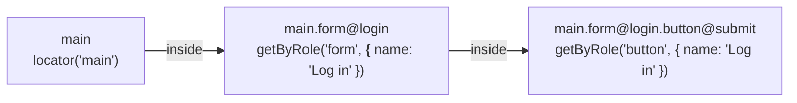

## Introduction

In Playwright you narrow a search by chaining: `page.locator("main").getByRole("button")` finds buttons inside
`main` ([matching inside a locator](https://playwright.dev/docs/locators#matching-inside-a-locator)). POMWright builds
that chain from a path. You register one locator per path, and resolving a path returns the Playwright
[`Locator`](https://playwright.dev/docs/api/class-locator) that chains them.

There are two ways to resolve a path:

| method | resolves | use it for |
| --- | --- | --- |
| `getNestedLocator(path)` | every registered segment of the path, first to last | every element you act on or assert |
| `getLocator(path)` | the path's own locator, without its ancestors | a chain you build yourself, or a locator inside a filter |

Both are synchronous and lazy, like Playwright's own locator methods: they build a `Locator` and touch nothing in the
browser until an action or assertion uses it.

The examples on this page use this registry:

```ts title="login.locators.ts"
import type { LocatorRegistry } from "pomwright";

export type Paths =
  | "main"
  | "main.form@login"
  | "main.form@login.button@submit";

export function defineLocators(registry: LocatorRegistry<Paths>) {
  registry.add("main").locator("main");
  registry.add("main.form@login").getByRole("form", { name: "Log in" });
  registry.add("main.form@login.button@submit").getByRole("button", { name: "Log in" });
}
```

against a page with two more "Log in" buttons, one beside the form and one in a dialog:

```html
<main>
  <form aria-label="Log in">
    <button>Log in</button>
  </form>
  <aside><button>Log in</button></aside>
</main>
<div role="dialog" aria-label="Session expired"><button>Log in</button></div>
```

## Chaining every segment: `getNestedLocator`

`getNestedLocator(path)` walks the path from its first segment to its last and chains the locator registered for each
one, with that segment's `filter` and `nth` steps right after it:

```ts
import type { LocatorRegistry } from "pomwright";
import type { Paths } from "./login.locators";

declare const registry: LocatorRegistry<Paths>;
// ---cut---
const submit = registry.getNestedLocator("main.form@login.button@submit");
// locator('main').getByRole('form', { name: 'Log in' }).getByRole('button', { name: 'Log in' })

await submit.click();
```

Each segment's locator is resolved inside the one before it:



The chain finds the form's button and not the other two, because each step searches inside the previous one. This is
why chaining is the default: the locator of the last segment can stay short (a role and a name) and still be unique,
since the path supplies the context. When the page changes structure, the path stops matching and the test fails,
instead of quietly finding a similar element elsewhere.

In a page object the same method is `this.getNestedLocator(path)`; see [your first page
object](/POMWright/docs/first-page-object/).

## A locator without its ancestors: `getLocator`

`getLocator(path)` resolves only the locator registered for the path itself, with its own steps. It brings no context
of its own: used on the page it searches the whole page, chained under another locator it searches inside that one.
Use it when you build the chain yourself, for example to find the registered button in a dialog that is not part of
its path:

```ts
import type { Page } from "@playwright/test";
import type { LocatorRegistry } from "pomwright";
import type { Paths } from "./login.locators";

declare const page: Page;
declare const registry: LocatorRegistry<Paths>;
// ---cut---
const submit = registry.getLocator("main.form@login.button@submit");

await page.getByRole("dialog", { name: "Session expired" }).locator(submit).click();
// getByRole('dialog', { name: 'Session expired' }).locator(getByRole('button', { name: 'Log in' }))
```

or as the inner locator of a filter, `page.getByRole("form").filter({ has: submit })`. A path given to
`filter({ has })` is resolved the same way, automatically, because Playwright evaluates `has` inside the element being
filtered; see [filters and indices](/POMWright/docs/filters-and-indices/).

On its own, for an element you act on, `getLocator` gives up what the chain provides. Here it matches all three "Log
in" buttons, and an action fails with Playwright's strict mode error:

```text
locator.click: Error: strict mode violation: getByRole('button', { name: 'Log in' }) resolved to 3 elements:
    1) <button>Log in</button> aka getByRole('form', { name: 'Log in' }).getByRole('button', { name: 'Log in' })
    2) <button>Log in</button> aka getByRole('complementary').getByRole('button', { name: 'Log in' })
    3) <button>Log in</button> aka getByRole('dialog', { name: 'Session expired' }).getByRole('button', { name: 'Log in' })
```

Even where a path's own locator happens to be unique today, resolve the chain: when the page gains a similar element
elsewhere, `getNestedLocator` still finds the one under its ancestors, and `getLocator` starts to fail.

## Segments without a locator

A segment does not need a locator of its own. A segment that has none is only a name that groups paths, and
resolution leaves it out of the chain:

```ts
import type { LocatorRegistry } from "pomwright";

declare const registry: LocatorRegistry<"main.form" | "main.form.button.submit">;
// ---cut---
registry.add("main.form").getByRole("form", { name: "Log in" });
registry.add("main.form.button.submit").getByRole("button", { name: "Log in" });

registry.getNestedLocator("main.form.button.submit");
// getByRole('form', { name: 'Log in' }).getByRole('button', { name: 'Log in' })
// "main" and "main.form.button" are names, not locators
```

The chain is then as specific as its registered segments. Only the path you resolve must be registered; resolving a
path that is not throws `No locator schema registered for path "main.form.button".` A project that wants every
segment registered can ask the registry to check it: see [`strictChains`](/POMWright/docs/verifying-registries/).

## What the report shows

A resolved locator carries its path as its [description](https://playwright.dev/docs/api/class-locator#locator-describe):
the HTML report shows the path next to each action and assertion, while the call log and a strict mode error show the
chain Playwright waited for. See [Descriptions](/POMWright/docs/descriptions/#where-playwright-shows-it).

## Changing a chain in one test

`getNestedLocator` and `getLocator` always resolve what is registered. To change a chain for one test (another name,
one more filter, an index, an ancestor left out) start a query with `getLocatorSchema(path)`; the registry itself never
changes. See [queries](/POMWright/docs/queries/).

## Frames

A segment registered with `frameLocator(selector)` is the `<iframe>` element, and the segments below it resolve
inside the frame, as Playwright's [`locator.contentFrame()`](https://playwright.dev/docs/api/class-locator#locator-content-frame)
does. See [frames](/POMWright/docs/frames/).

## Reference

- [`LocatorRegistry.getNestedLocator()`](/POMWright/api/class-locatorregistry/#getnestedlocator) and
  [`getLocator()`](/POMWright/api/class-locatorregistry/#getlocator)
- [`PageObject`](/POMWright/api/class-pageobject/), whose `getNestedLocator` and `getLocator` are the same methods
- Playwright: [Locators](https://playwright.dev/docs/locators), [`Locator`](https://playwright.dev/docs/api/class-locator)
