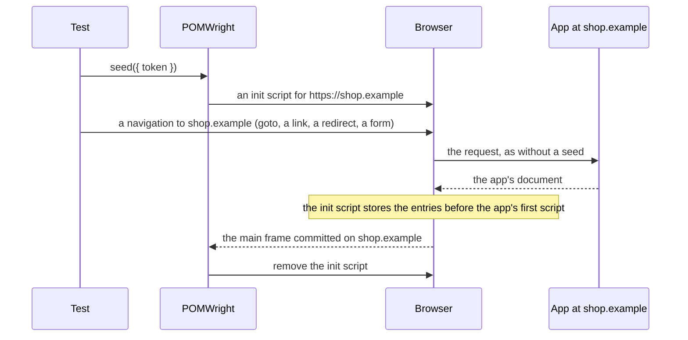

## Introduction

An app often reads session storage once, as it starts: a token, a feature flag, a basket. Writing the value after the
app has loaded is too late, and writing it after a first load then reloading loads the app twice. Playwright's
[`addInitScript`](https://playwright.dev/docs/api/class-page#page-add-init-script) runs before the app's first script,
but on every load until it is removed, so it would overwrite what the app writes. `seed` uses it for one arrival: it
stores the entries for an origin before the app's next load there, so the app's first script already sees them, and
then gets out of the way.

```ts
import { test } from "./fixtures";

test("a returning customer", async ({ loginPage }) => {
  await loginPage.sessionStorage.seed({ token: "eyJ…" }); // pending for https://shop.example
  await loginPage.navigation.goto(); // the app's first script already sees the token
});
```

## How it works

When the page is already on the origin, `seed` writes at once; the app sees the entries the next time it reads
storage, so reload or navigate if it reads only at startup. A popup at `about:blank` whose document inherited the origin
from its opener counts as on it, as it does for `set`. Otherwise the entries wait for the origin. POMWright adds an
init script to the page that stores them when the page's main frame first arrives at the origin, before the app's first
script runs, whatever takes the page there (`goto`, a link, a script, a form POST, a server redirect or a chain of
them) and whatever answers (the server, a service worker, a route the test registered). Once that document has run the
script, POMWright removes it:



The script writes only on the first arrival at the origin. If the app writes a seeded key and then reloads, or moves to
another page on the same origin, before the script is removed, the script leaves the app's value alone.

The navigation itself is never intercepted. The page the test is on is never left before it, so an origin can be seeded
with data the test learns on the previous one. When the entries are applied, POMWright removes its listeners: a test
that never seeds runs exactly as it would without POMWright.

## Two patterns

When everything is known up front, seed every origin first, then start the flow. Session storage is per tab and per
origin, so each origin keeps its entries while the page is elsewhere:

```ts
import { SessionStorage } from "pomwright";
import { test } from "./fixtures";

test("a consent page on the identity provider", async ({ loginPage, page }) => {
  const identityProvider = new SessionStorage(page, { label: "Login", origin: "https://login.example" });

  await identityProvider.seed({ consent: "given" });
  await loginPage.sessionStorage.seed({ token: "eyJ…" });
  await loginPage.navigation.goto();
});
```

When a value is learned on the way, seed the next origin before the hop:

```ts
import { SessionStorage } from "pomwright";
import { test } from "./fixtures";

test("a payment origin", async ({ checkoutPage, page }) => {
  const payment = new SessionStorage(page, { label: "Payment", origin: "https://pay.example" });

  await checkoutPage.navigation.goto();
  const orderId = await checkoutPage.orderId();
  await payment.seed({ orderId }); // the page stays on shop.example
  await checkoutPage.pay(); // the app sends the browser to pay.example
});
```

## Several seeds

Await each `seed` before the action that starts the hop. A `seed` that is still registering when the page arrives at
its origin fails, because that document may have loaded without the entries. Without `await`, the call races the
navigation: depending on the browser and the timing, it applies or it fails. A failure that nothing awaits fails the
test as an unhandled rejection, and a test that ends before the hop fails because the seed was never applied. The
[`no-floating-promises`](https://typescript-eslint.io/rules/no-floating-promises/) lint rule of typescript-eslint
finds a missing `await`.

Calls for one origin merge, in the order they were made, later values winning per key. One call with every entry
says the same:

```ts
import { test } from "./fixtures";

test("a returning customer in Norwegian", async ({ loginPage }) => {
  await loginPage.sessionStorage.seed({ token: "eyJ…", locale: "en" });
  await loginPage.sessionStorage.seed({ locale: "nb" });
  // the same as seed({ token: "eyJ…", locale: "nb" })
  await loginPage.navigation.goto();
});
```

The calls merge the same way when they overlap, as in a `Promise.all`, whether the page is on the origin or not. For
one origin that gains nothing, since the calls still run one after the other. For several origins they register at the same time, instead of one after the
other. A seed can also run beside work that does not touch the page, such as an API request, as long as everything is
awaited before the hop:

```ts
import { SessionStorage } from "pomwright";
import { test } from "./fixtures";

test("a consent page, both origins seeded at once", async ({ loginPage, page }) => {
  const identityProvider = new SessionStorage(page, { label: "Login", origin: "https://login.example" });

  await Promise.all([identityProvider.seed({ consent: "given" }), loginPage.sessionStorage.seed({ token: "eyJ…" })]);
  await loginPage.navigation.goto();
});
```

## What a seeded navigation looks like to the app

Exactly as without a seed: the same request with the same `Referer` and `Sec-Fetch-*` headers, the same method and
body, the same history entry and navigation type, the same URL fragment. `page.goto` returns the app's response. With
`waitUntil: "commit"`, the committed document is the app's and already has the entries.

## What `seed` cannot do

| case | what happens |
| --- | --- |
| the seed is still waiting when the page closes | the test fails, naming the origin and the keys: remove the `seed` call, or navigate there before the test ends; do not seed in a fixture that some tests never use |
| the hop opens a new tab | a new tab has its own session storage and does not run the page's init scripts; the seed waits on and fails the test when the page closes. Seed the new tab yourself with [`browserContext.addInitScript`](https://playwright.dev/docs/api/class-browsercontext#browser-context-add-init-script), or `set` the entries in it and reload it |
| `seed` is called once the page has committed a document on the origin, as after `await link.click()` on a link there or `goto(…, { waitUntil: "commit" })` | the page is on the origin, so `seed` writes at once, after that document's first script has run without the entries. Seed before the action that starts the navigation |
| `seed` is not awaited before the hop, or a navigation to the origin is already under way when it is called | depending on the timing, it applies, or it fails because the document may have loaded without the entries. Await the seed before the action that starts the hop: see [Several seeds](/POMWright/docs/seeding-session-storage/#several-seeds) |
| a navigation to the origin fails while the seed waits (a refused connection, offline, `route.abort()`) | the browser's error page, and on Chromium the arrival after it, cannot receive the seed: on Chromium and Firefox the test fails, naming the reason; on WebKit the next arrival receives it |
| a browser without the [Navigation API](https://developer.mozilla.org/en-US/docs/Web/API/NavigationActivation/from) | `seed` fails at the call, before anything is registered: use `set` on the origin and reload instead. Every browser Playwright 1.64 ships has it |
| the browser refuses the write (the storage quota) | the app loads without the entries and the test fails |

Every one of these failures points at the line that called `seed`.

## Several origins and frames

Each origin's entries stay while the page is elsewhere: seed A and B, load A, let the app hop to B and back, and A
still has what was seeded and written there. Nothing carries entries from one origin to another. A same-origin iframe
shares the page's storage; a cross-site iframe of a seeded origin shares that origin's storage in Chromium and Firefox,
while WebKit keeps it apart. The script writes only in the main frame, so an iframe on the seeded origin inside another
page neither receives the entries nor uses up the seed. A hop started from an iframe with `top.location` is a main-frame
navigation and is seeded.

## Errors

```text
Shop.SessionStorage.seed: an origin is required; pass { origin } or construct the helper with one
Shop.SessionStorage.seed: value for "orderId" is not a string and no codec is declared for it; declare one in the schema (a page object's sessionStorage.schema option)
Shop.SessionStorage.seed: value for "orderId" could not be encoded
Shop.SessionStorage.seed: the codec for "orderId" returned undefined instead of a string
Shop.SessionStorage.seed: the page committed a document on https://pay.example while seed() was registering, so the app may have started without the entries; await that navigation before seeding, or seed before starting it
Shop.SessionStorage.seed: seed() needs the Navigation API (navigation.activation) to write only on the first arrival at https://pay.example, and this browser has none (Mozilla/5.0 …); use set() on the origin and reload instead
Shop.SessionStorage.seed: the page closed while seed() was registering the seed for https://pay.example (keys: orderId); await seed() before the test ends
Shop.SessionStorage.seed: could not write sessionStorage for https://pay.example (keys: orderId): QuotaExceededError: The quota has been exceeded.; the app loaded without the entries
Shop.SessionStorage.seed: the seed for https://pay.example (keys: orderId) was never applied: the page closed without navigating there; remove the seed call, or navigate to the origin before the test ends
Shop.SessionStorage.seed: the seed for https://pay.example (keys: orderId) was not applied: the document that arrived on https://pay.example has an opaque origin (the browser's error page after a failed navigation, or a sandboxed document)
Shop.SessionStorage.seed: the seed for https://pay.example (keys: orderId) was not applied: the browser counted the page's arrival on https://pay.example as a return there (navigation.activation.from is set): the document before it was already on the origin, as after a failed navigation to it
```

The first seven are thrown by the `seed` call; the last four fail the test later, when the app's document loads or when
the page closes. When seeds for several origins are never applied, one error lists each with its helper and the line that
called it (`2 seeds were never applied: …`, then one line per seed).

## Reference

- [`SessionStorage.seed()`](/POMWright/api/class-sessionstorage/#seed)
- [The seed registry](/POMWright/internal/seed-registry/), how it works inside
- Playwright: [`page.sessionStorage`](https://playwright.dev/docs/api/class-page#page-session-storage),
  [`page.addInitScript()`](https://playwright.dev/docs/api/class-page#page-add-init-script)
