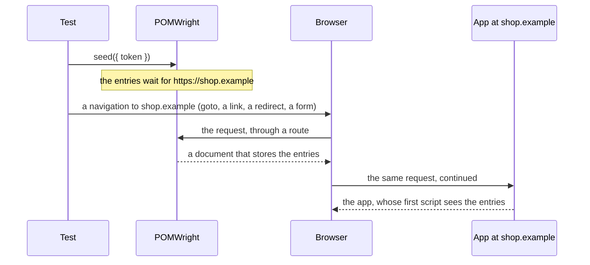

## Introduction

An app often reads session storage once, as it starts: a token, a feature flag, a basket. Writing the value after the
app has loaded is too late, and Playwright's ways around that each have a cost:
[`addInitScript`](https://playwright.dev/docs/api/class-page#page-add-init-script) runs before every load and
overwrites what the app writes, and writing after a first load then reloading loads the app twice. `seed` stores the
entries for an origin before the app's next load there, so the app's first script already sees them, and then gets out
of the way.

```ts
import { test } from "./fixtures";

test("a returning customer", async ({ loginPage }) => {
  await loginPage.sessionStorage.seed({ token: "eyJ…" }); // pending for https://shop.example
  await loginPage.navigation.goto(); // the app's first script already sees the token
});
```

## How it works

When the page is already on the origin, `seed` writes at once; the app sees the entries the next time it reads
storage, so reload or navigate if it reads only at startup. Otherwise the entries wait for the origin. The next
navigation of the page's main frame that reaches it, by `goto`, a link, a script, a form POST, a server redirect or a
chain of them, is answered with a small document of POMWright's own that stores the entries and continues the
navigation; the app's document is loaded after that:



The page the test is on is never left before that navigation, so an origin can be seeded with data the test learns on
the previous one. The navigation keeps its URL fragment (`#/orders/7`, `#access_token=…`), and `page.goto` returns
once the app's document has loaded, as without a seed. When the entries are applied, POMWright removes its route and
listeners: a test that never seeds runs exactly as it would without POMWright.

## Two patterns

When everything is known up front, seed every origin first, then start the flow. Session storage is per tab and per
origin, so each origin keeps its entries while the page is elsewhere:

```ts
import { SessionStorage } from "pomwright";
import { test } from "./fixtures";

test("a consent page on the identity provider", async ({ loginPage, page }) => {
  const identityProvider = new SessionStorage(page, { label: "Login", origin: "https://login.example" });

  await identityProvider.seed({ consent: "given" });
  await loginPage.sessionStorage.seed({ token: "eyJ…" });
  await loginPage.navigation.goto();
});
```

When a value is learned on the way, seed the next origin right before the hop:

```ts
import { SessionStorage } from "pomwright";
import { test } from "./fixtures";

test("a payment origin", async ({ loginPage, page }) => {
  const payment = new SessionStorage(page, { label: "Payment", origin: "https://pay.example" });

  await loginPage.navigation.goto();
  const orderId = (await page.getByTestId("order-id").textContent()) ?? "";
  await payment.seed({ orderId }); // the page stays on shop.example
  await page.getByRole("button", { name: "Pay" }).click(); // the app sends the browser to pay.example
});
```

Seed as late as you can, right before the hop: while a seed waits, navigations of the main frame to other origins are
fetched by Playwright and handed back to the browser, which is how a server redirect towards the seeded origin is
seen. Sub-resources, API calls and iframes pass through untouched, and the moment the seed is applied this stops.

## What a seeded navigation looks like to the app

POMWright's document occupies the target URL for a few milliseconds, then replaces itself with the real request.
That request carries no `Referer` and `Sec-Fetch-Site: same-origin`, since a document on the origin issues it. A
navigation fetched while a seed waits carries the browser's own `User-Agent`, cookies and client hints, and
synthesised `Sec-Fetch-*` headers. A form POST is re-submitted with the same fields; a 307 or 308 redirect keeps its
method and body.

## What `seed` cannot do

| case | what happens |
| --- | --- |
| the seed is still waiting when the page closes | the test fails, naming the origin and the keys: remove the `seed` call, or navigate there before the test ends; do not seed in a fixture that some tests never use |
| a service worker registered by the app answers the navigation | Playwright's routes never see it; the app loads without the entries and the test fails at once with the fixes (next section) |
| a route the test registered after `seed` fulfils the navigation | the same failure; let that route call [`route.fallback()`](https://playwright.dev/docs/api/class-route#route-fallback) for it |
| a whole-page mock registered before `seed`, for a navigation to another origin | bypassed while the seed waits: the real page loads. Register whole-page mocks after `seed`; API and sub-resource mocks are not affected |
| a `multipart/form-data` or `text/plain` form POST to the origin | it cannot be re-issued; it passes through without the entries and the test fails, naming the method |
| the hop opens a new tab | a new tab has its own session storage; the seed waits on and fails the test when the page closes |
| `waitUntil: "commit"` | the committed document may still be POMWright's; wait for `load`, `domcontentloaded` or an element instead |

Every one of these failures points at the line that called `seed`.

## Service workers

Playwright's routes do not see a navigation that a service worker answers. When the app has registered a worker that
serves navigations itself, a waiting seed for that origin is bypassed and the test fails at once:

```text
LoginPage.SessionStorage.seed: the page navigated to https://shop.example/orders but the pending seed for https://shop.example was not applied; the navigation was not intercepted: a service worker registered by the app answered it, or a route the test registered after seed() fulfilled it; the app ran without the entries. Fixes: set use: { serviceWorkers: "block" } in the Playwright config; seed before the app's first load in this context; unregister the worker in the test before seeding; or let the test's own route call route.fallback() for that navigation
```

The fixes, and what each changes:

- [`serviceWorkers: "block"`](https://playwright.dev/docs/api/class-testoptions#test-options-service-workers) in the
  config or `test.use(…)`: the worker never registers, so what needs it (offline caching, push) is not exercised.
- Seed before the app's first load in the browser context: a new context has no worker yet.
- Unregister the worker in the test before seeding; the app registers it again on its next load.
- When the worker must stay and the seed must come after the app has loaded, use `set` and reload the page instead.

## Several origins and frames

Each origin's entries stay while the page is elsewhere: seed A and B, load A, let the app hop to B and back, and A
still has what was seeded and written there. Nothing carries entries from one origin to another. A same-origin iframe
shares the page's storage; a cross-site iframe of a seeded origin shares that origin's storage in Chromium and Firefox,
while WebKit keeps it apart. A hop started from an iframe with `top.location` is a main-frame navigation and is seeded.

## Errors

```text
Shop.SessionStorage.seed: an origin is required; pass { origin } or construct the helper with one
Shop.SessionStorage.seed: the seed for https://pay.example (keys: orderId) was never applied: the page closed without navigating there; remove the seed call, or navigate to the origin before the test ends
Shop.SessionStorage.seed: cannot re-issue a POST text/plain navigation to https://pay.example; the app loaded without the entries. Only GET and application/x-www-form-urlencoded POST navigations can be seeded
Shop.SessionStorage.seed: could not fetch https://down.example/ while a seed for https://pay.example was pending
```

## Reference

- [`SessionStorage.seed()`](/POMWright/api/class-sessionstorage/#seed)
- Playwright: [`page.sessionStorage`](https://playwright.dev/docs/api/class-page#page-session-storage),
  [`page.route()`](https://playwright.dev/docs/api/class-page#page-route),
  [Service workers](https://playwright.dev/docs/service-workers)
