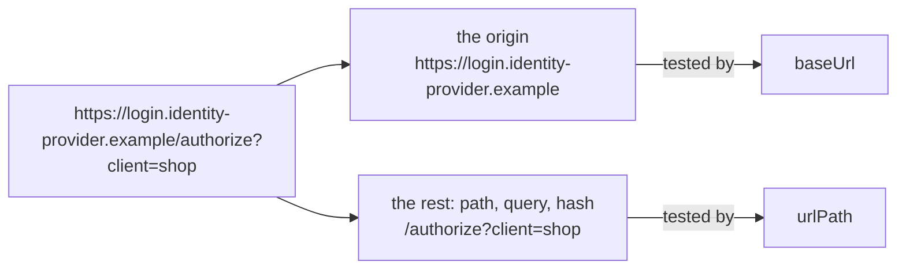

## Introduction

Playwright resolves a relative `page.goto("/login")` against the project's
[`baseURL`](https://playwright.dev/docs/api/class-testoptions#test-options-base-url), and waits for a URL with
[`page.waitForURL()`](https://playwright.dev/docs/api/class-page#page-wait-for-url). POMWright gives every page object
its own base, the `baseUrl`, and its own path, the `urlPath`, so a suite that spans several sites needs no shared
setting, and builds a navigation helper from them: `goto` to go there, `expectThisPage` and `expectAnotherPage` to wait
until the browser is there or has left. Each is one Playwright call, with Playwright's waits and timeouts.

## `baseUrl` and `urlPath`

A string `baseUrl` is an origin: scheme, host and an optional port, with or without a trailing slash, and nothing
after it (`https://shop.example`, `http://localhost:9000`). A string `urlPath` is `""` for the origin itself, or starts
with exactly one `/` (`/login`, `/orders?tab=open`). The constructor checks both, so a value from the environment is
checked like a literal:

```text
LoginPage: baseUrl must be an origin such as "https://example.com" or "http://localhost:9000" (scheme, host, optional port, no path, query or hash); received "shop.example".
LoginPage: urlPath must be "" or start with exactly one "/"; received "login".
LoginPage: baseUrl must be a string or a RegExp; received undefined.
```

`localhost:9000` without a scheme and a base with a path are rejected: Playwright could not resolve paths against the
first, and would drop the path of the second for every path that starts with `/`. A path that starts with `//` would
name another host.

## `fullUrl`

For two strings, `fullUrl` is `new URL(urlPath, baseUrl).href`, the URL in the form the browser reports it:

| `baseUrl` | `urlPath` | `fullUrl` |
| --- | --- | --- |
| `"https://shop.example"` | `""` | `https://shop.example/` |
| `"https://shop.example/"` | `"/login"` | `https://shop.example/login` |
| `"https://shop.example"` | `"/søk"` | `https://shop.example/s%C3%B8k` |
| `"http://localhost:9000"` | `"/orders?tab=1"` | `http://localhost:9000/orders?tab=1` |

## Navigating

Every page object has a `navigation` helper:

| method | does |
| --- | --- |
| `goto(options?)` | `page.goto(fullUrl)`, then the page object's [actions after navigation](/POMWright/docs/page-objects/#actions-after-navigation) |
| `goto(target, options?)` | `page.goto` to `target`, resolved against `baseUrl` exactly as Playwright resolves against `baseURL` (`goto("/account")`, `goto("?tab=2")`); never runs the actions |
| `expectThisPage(options?)` | one `page.waitForURL` for this page's URL, then the actions |
| `expectAnotherPage(options?)` | one `page.waitForURL` for any other URL, then a check that the browser did not come straight back |

```ts
import { test } from "./fixtures";

test("the account link", async ({ loginPage }) => {
  await loginPage.navigation.goto();
  await loginPage.logIn("ada@shop.example", "correct horse");
  await loginPage.navigation.expectAnotherPage();
  await loginPage.navigation.goto("/account");
});
```

A page's identity is its exact URL: `/orders?tab=1` is not `/orders` for `expectThisPage`, and counts as another page
for `expectAnotherPage`. When the URL is already right, `page.waitForURL` returns at once, after the requested load
state, so calling `expectThisPage()` after a navigation that has already landed is fine. A `goto(target)` whose target
happens to equal `fullUrl` is ordinary navigation and does not run the actions.

Each call is a step of the report (`LoginPage: Navigate to this Page`, `LoginPage: Expect this Page`, …), shown at the
line that called it.

## Options and timeouts

```ts
type NavigationOptions = {
  waitUntil?: "load" | "domcontentloaded" | "networkidle" | "commit";
  timeout?: number;
};
```

`goto()` and `expectThisPage()` also take `runPostNavigationActions: false`. Each option comes from the call, then
from the page object's `navOptions`, then from Playwright: `waitUntil` defaults to `"load"`, and `timeout` to the
project's [`navigationTimeout`](https://playwright.dev/docs/api/class-testoptions#test-options-navigation-timeout).
POMWright sets no timeout or load state of its own, and every method makes one waiting call, so its limit is one
timeout:

```ts
import type { Page } from "@playwright/test";
import { PageObject } from "pomwright";

export class OrdersPage extends PageObject<"main"> {
  constructor(page: Page) {
    super(page, "https://shop.example", "/orders", {
      label: "OrdersPage",
      navOptions: { waitUntil: "domcontentloaded", timeout: 15_000 },
    });
  }

  protected defineLocators(): void {
    this.add("main").locator("main");
  }
}
```

A wait that times out names the page object, what it expected and the URL found, with Playwright's error as `cause`:

```text
OrdersPage: expected URL "https://shop.example/orders"; found "https://shop.example/orders?tab=1" (page.waitForURL: Timeout 15000ms exceeded.)
OrdersPage: expected to have left "https://shop.example/orders"; found "https://shop.example/orders" (page.waitForURL: Timeout 15000ms exceeded.)
OrdersPage: left "https://shop.example/orders" but returned to it; found "https://shop.example/orders"
```

## Pages whose URL varies

A `baseUrl` or `urlPath` may be a RegExp: an account page at `/account/42`, or a login page on an identity provider
whose host changes between environments. Declare which in the page object's second type argument:

```ts
import type { Page } from "@playwright/test";
import { PageObject } from "pomwright";

export class AccountPage extends PageObject<"main", { urlPathType: RegExp }> {
  constructor(page: Page) {
    super(page, "https://shop.example", /^\/account\/\d+$/, { label: "AccountPage" });
  }

  protected defineLocators(): void {
    this.add("main").locator("main");
  }
}
```

`fullUrl` is then a `UrlMatcher`, which tests the two parts of a URL separately, each part as written, with its own
flags; a string part must match exactly:



| `baseUrl` + `urlPath` | matches `https://login.identity-provider.example/authorize?client=shop` |
| --- | --- |
| `/identity-provider/` + `/\/authorize/` | yes |
| `/identity-provider/` + `"/authorize"` | no: a string path is exact, and the query follows |
| `/\.example$/` + `/^\/authorize\?client=\w+$/` | yes |
| `/authorize/` + `/\/authorize/` | no: the base only sees the origin |
| `"https://login.identity-provider.example/"` + `/\/authorize/` | yes |

So `^` and `$` on a base refer to the origin, a path prefix belongs in `urlPath`, and `$` on a base includes the port
(`/example(?::\d+)?$/` allows one). A `UrlMatcher` works wherever Playwright takes a URL predicate:
`page.waitForURL(fullUrl)`, `expect(page).toHaveURL(fullUrl)`, `page.route(fullUrl, …)`. It also has `test(url)`,
`base`, `path`, and a readable `toString()` (`origin "https://shop.example" + path /^\/account\/\d+$/`).

Such a page has no single URL to go to, so `goto()` without a target is not available (a compile error, and from
JavaScript: `AccountPage: goto() without a URL needs a string fullUrl; this page object has a RegExp URL. Pass an
absolute URL instead.`). `goto(target)` still works; on a RegExp `baseUrl` the target must be absolute.

A page whose identity includes a query, `/orders?tab=2`, is such a page too: `urlPath: /^\/orders\?tab=\d+$/`.

## Reference

- [Navigation](/POMWright/api/class-navigation/): `NavigationFor`, `NavigationOptions`, `ThisPageOptions`, `UrlMatcher`
- [`PageObject` constructor](/POMWright/api/class-pageobject/#new-pageobject)
- Playwright: [`baseURL`](https://playwright.dev/docs/api/class-testoptions#test-options-base-url),
  [`page.goto()`](https://playwright.dev/docs/api/class-page#page-goto),
  [`page.waitForURL()`](https://playwright.dev/docs/api/class-page#page-wait-for-url),
  [`toHaveURL()`](https://playwright.dev/docs/api/class-pageassertions#page-assertions-to-have-url)
