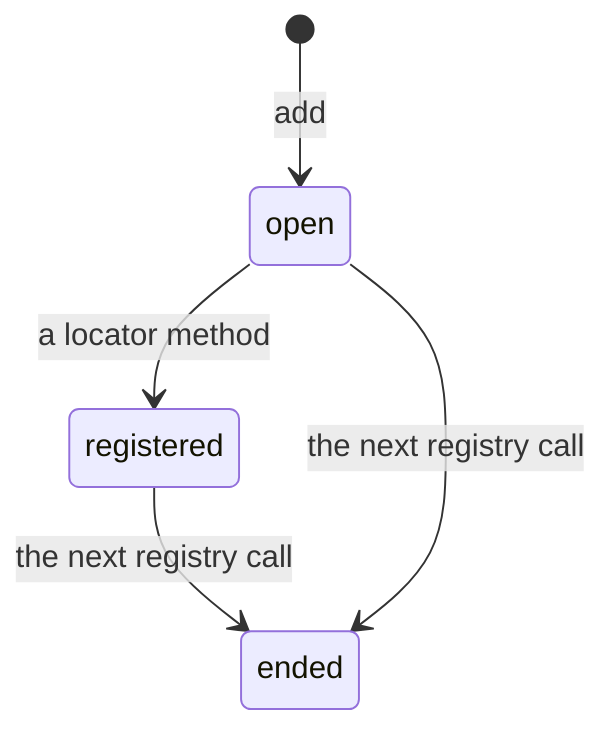

Everything `add`, `getLocatorSchema`, `update`, `replace` and `createReusable` return is a builder: an object whose
methods record what you chain and return the next step. Builders are synchronous and not thenable: there is nothing
to `await`, as with Playwright's own locator methods. This page explains how each builder keeps its state and when it
writes; how to use them is on [Registering locators](/POMWright/docs/registering-locators/),
[Queries](/POMWright/docs/queries/) and [Reusing locators](/POMWright/docs/reusing-locators/).

## The registration

`add(path)` returns a `LocatorRegistrationBuilder` (`src/locators/locatorRegistrationBuilder.ts`) through a narrower
type, so TypeScript offers the right methods at each step:

- before a locator method, only the ten locator methods (`LocatorRegistrationPreDefinitionBuilder`);
- after one, only `filter`, `nth` and `describe`: the locator method returns a small view object with those three,
  whose methods record a step and return the view again.

A registration goes through three states. A locator method registers the record, each step (`filter`, `nth`,
`describe`) replaces it, and the next call on the registry ends the registration, after which every method of it throws:

The builder writes the registry on every call: the first call registers, later ones replace the record, so the record
grows with the chain. A chain has no end the builder can see, so the registry ends it: it keeps the registration the
latest `add` started and ends it at its next call (`add`, `getLocator`, `getNestedLocator`, `getLocatorSchema`,
`verify`, or a resolution, a query's included). Every method of an ended registration checks that first and throws, so
a registration kept in a variable cannot change its path once anything else has happened on the registry, and nothing
that reads the registry sees a registration still changing. From JavaScript, a step before a locator method or a
second locator method throws, naming the path.

With `{ reuse: seed }` the builder starts from the seed's record and registers it at once. Its one optional call of the
seed's own locator method patches the record as `update` does. Another strategy's method throws, and so does a second
call on a registration kept in a variable; a call that throws leaves the record as it was. With
`{ reuse: "other.path" }` it starts from a copy of that record and returns only the view: a copy keeps the locator it
reused.

## The query

`getLocatorSchema(path)` returns a `LocatorQueryBuilderInternal` (`src/locators/locatorQueryBuilder.ts`). It holds
copies of the path's chain: a map of definitions, a map of steps and a map of descriptions by segment, plus the set of
segments `skip` has left out. Its methods change those maps and return the query itself, so a query chains and can be
kept in a variable; `getNestedLocator()` and `getLocator()` hand the maps to the registry's `buildLocatorChain`.

`skip` is a flag in the set, so `unskip` restores a segment exactly as it was. A change to a skipped segment throws
until `unskip`, because a change nobody would see in the resolved chain is more likely a mistake than an intent.

## Path parameters are generic

Every method that takes a path takes it as a type parameter, `<Path extends Paths>(path: LocatorSchemaPathArgument<Path>)`,
not as the union itself: the path's own type decides what follows it. It is what lets `getLocatorSchema` accept only
the path's own segments as sub-paths, and what checks the format of a literal or template literal path where it is
passed.

An editor's rename follows from this. TypeScript's language service treats two string literals as one when they have
the same text and the same contextual type. A member of `Paths` has the union as its type, and a use has the path's own
literal type, so a rename from the member reaches only the member, and one from a use reaches every use, sub-path
arguments included (see [one path gets a new name](/POMWright/docs/locator-paths/#one-path-gets-a-new-name)). A
parameter typed as the union would link the member to its uses, but only in the methods typed that way:
`getLocatorSchema` and the sub-path arguments must stay generic, so a plain overload on `getNestedLocator` would split
its uses from theirs and make a rename reach fewer places than today. Probed against the TypeScript 6.0.3 language
service; not adopted.

## The update builder

`update(subPath?)` and `replace(subPath?)` return a `LocatorUpdateBuilderInternal`
(`src/locators/locatorUpdateBuilder.ts`) with a type parameter `Mode`, `"update"` or `"replace"`. The same ten methods
take different argument lists per mode: in `replace` mode Playwright's own (the first argument required, Playwright's
option types), in `update` mode the patch shapes (the first argument optional, `null` deleting options). The builder
applies the call to the query through a callback and returns the query: `update` merges into the segment's definition
and requires its strategy, `replace` builds a complete definition of any strategy.

## Public types are aliases

A public builder type is a type alias over the internal class, declared under the public name:
`type LocatorQueryBuilder<…> = LocatorQueryBuilderInternal<…>`. A class re-exported as a type would be written into the
bundled declarations' export list as a value, so a consumer's `new` would compile and then fail at run time, since the
bundle exports nothing by that name. The alias keeps the class internal: hovers and errors show the public name, and the
internal one appears only in the error for a private member. The class's doc comments are the public documentation.
Every public method returns a type a consumer can import, except the registration views, which are used in one statement
and never named.
