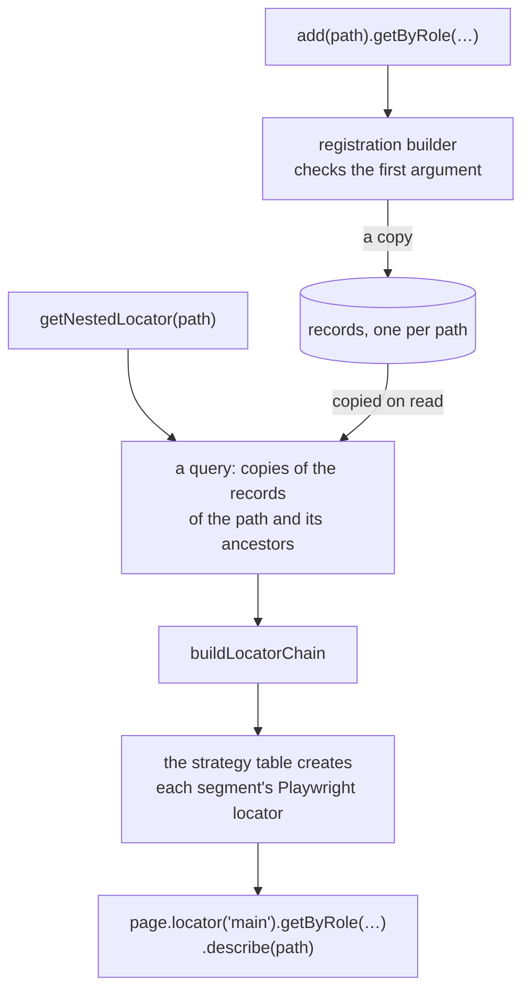

This section explains how POMWright is built and why, for contributors and for users who want to know what happens
under a call. The rules a change must keep are in
[AGENTS.md](https://github.com/DyHex/POMWright/blob/main/AGENTS.md), the contributor guide; these pages explain the
parts those rules protect.

## The modules

POMWright is a TypeScript library over `@playwright/test`, which it never depends on at run time: Playwright is a peer
dependency. The source is in `src/`:

| module | what it holds |
| --- | --- |
| `src/locators/` | the registry (`locatorRegistry.ts`), the builders `add(path)`, `getLocatorSchema(path)`, `update`, `replace` and `createReusable` return, the strategy table and the path rules (`utils.ts`), the types (`types.ts`) |
| `src/pageObject.ts` | the `PageObject` base class |
| `src/helpers/` | URLs (`url.ts`), the navigation helper (`navigation.ts`), session storage (`sessionStorage.ts`) and its seeding (`sessionStorageSeed.ts`), the logger, `@step`, call sites (`callSite.ts`) |
| `src/fixture/base.fixtures.ts` | POMWright's `test`, with the `log` fixture |

## What is public

The public API is exactly what `index.ts`, the package entry, re-exports. Everything else in `src/` is internal, even
where it carries an `export` for another module or a test. Public types are type aliases over internal classes, such
as `LocatorQueryBuilder` over `LocatorQueryBuilderInternal`, for the reason in [builders](/POMWright/internal/builders/).

## From `add(path)` to a `Locator`

A path's locator is registered once, as a record, and every resolution builds a new chain from copies of the records:

1. `add(path)` returns a registration builder. Its locator method checks the first argument against the
   [strategy table](/POMWright/internal/strategies-table/) and stores a [record](/POMWright/internal/registry-records/);
   each later step replaces the record.
2. `getNestedLocator(path)` starts a query, which copies the records of the path and of its registered ancestors.
   `getLocator(path)` copies the path's record alone.
3. [Resolution](/POMWright/internal/resolution/) walks the chain from the first segment to the path, creating each
   segment's locator on the one before it, applying its steps, entering frames, and describing the result with the
   path.

Nothing touches the page until the `Locator` is used: resolving is synchronous and only builds the selector chain, as
Playwright's own locator methods do.

## Read next

- [Registry records](/POMWright/internal/registry-records/) and [resolution](/POMWright/internal/resolution/)
- [The strategy table](/POMWright/internal/strategies-table/) and [builders](/POMWright/internal/builders/)
- [The page object lifecycle](/POMWright/internal/page-object-lifecycle/), [URL matching](/POMWright/internal/url-matching/)
- [The seed registry](/POMWright/internal/seed-registry/), [call sites](/POMWright/internal/call-sites/)
- [Packaging](/POMWright/internal/packaging/), [tests and checks](/POMWright/internal/tests-and-checks/),
  [documentation](/POMWright/internal/documentation/)
