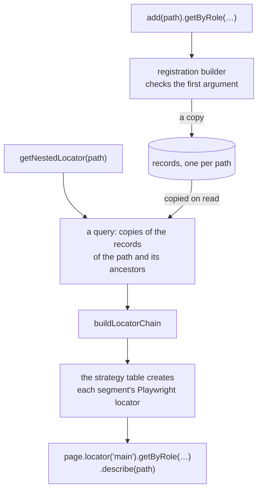

This section explains how POMWright is built and why, for contributors and for users who want to know what happens
under a call. The [Docs](/POMWright/docs/installation/) show how to use each part and the [API](/POMWright/api/) what
each method takes and throws; these pages explain the mechanism underneath and the reasons for it. The rules a change
must keep are in [AGENTS.md](https://github.com/DyHex/POMWright/blob/main/AGENTS.md), the contributor guide; these
pages explain the parts those rules protect.

## The terms

The pages of this section use these words in one meaning each:

| term | what it is |
| --- | --- |
| path | a dot-delimited name, `main.form@login.button@login`, one per locator |
| segment | one prefix of a path: `main`, `main.form@login`, `main.form@login.button@login` |
| definition | a locator's strategy and its arguments, such as `{ type: "role", role: "button", options: { name: "Log in" } }` |
| step | a `filter` or an index (`nth`, `first`, `last`) applied after the definition |
| record | what the registry stores for a path: the definition, the steps and an optional description |
| registration | the builder `add(path)` returns, which writes the path's record as its chain is called |
| chain | the Playwright locator built from the records of a path's registered segments |
| query | the builder `getLocatorSchema(path)` returns: a private copy of a chain's records, changed for one use |
| seed | a definition with steps, made by `createReusable` and registered nowhere until a path reuses it |
| resolution | building a Playwright `Locator` from records; it never touches the browser |

## The modules

POMWright is a TypeScript library over `@playwright/test`, which it never depends on at run time: Playwright is a peer
dependency. The source is in `src/`:

| module | what it holds |
| --- | --- |
| `src/locators/locatorRegistry.ts` | the registry: records, the open registration, resolution (`buildLocatorChain`), `verify()` |
| `src/locators/locatorRegistrationBuilder.ts` | what `add(path)` returns, seeded registrations included |
| `src/locators/locatorQueryBuilder.ts`, `locatorUpdateBuilder.ts` | the query, and what its `update()` and `replace()` return |
| `src/locators/reusableLocatorBuilder.ts` | `createReusable` and its seeds |
| `src/locators/utils.ts`, `types.ts` | the strategy table, the path rules, the copy helpers; the definition and record types |
| `src/pageObject.ts` | the `PageObject` base class and its lifecycle |
| `src/helpers/` | URLs (`url.ts`), the navigation helper (`navigation.ts`), session storage (`sessionStorage.ts`) and its seeding (`sessionStorageSeed.ts`), the logger, `@step`, call sites (`callSite.ts`) |
| `src/fixture/base.fixtures.ts` | POMWright's `test`, with the `log` fixture |

## What is public

The public API is exactly what `index.ts`, the package entry, re-exports. Everything else in `src/` is internal, even
where it carries an `export` for another module or a test, so it can change without a major release. Public types are
type aliases over internal classes, such as `LocatorQueryBuilder` over `LocatorQueryBuilderInternal`, for the reason
in [builders](/POMWright/internal/builders/#public-types-are-aliases).

## From `add(path)` to a `Locator`

A path's locator is registered once, as a record, and every resolution builds a new chain from copies of the records:

1. `add(path)` returns a registration builder. Its locator method checks the first argument against the
   [strategy table](/POMWright/internal/strategies-table/) and stores a [record](/POMWright/internal/registry-records/);
   each later step replaces the record, until the registration ends at the next call on the registry.
2. `getNestedLocator(path)` starts a query, which copies the records of the path and of its registered ancestors.
   `getLocator(path)` copies the path's record alone.
3. [Resolution](/POMWright/internal/resolution/) walks the chain from the first segment to the path, creating each
   segment's locator on the one before it, applying its steps, entering frames, and describing the result with the
   path.

Nothing touches the page until the `Locator` is used: resolving is synchronous and only builds the selector chain, as
Playwright's own locator methods do.

## Read next

The pages build on each other in this order:

1. [Registry records](/POMWright/internal/registry-records/): what is stored, and why nothing stored can change.
2. [Resolution](/POMWright/internal/resolution/): how records become a chain, and what `verify()` checks; and
   [Performance](/POMWright/internal/performance/): what that costs.
3. [The strategy table](/POMWright/internal/strategies-table/) and [builders](/POMWright/internal/builders/): the code
   that writes and changes records.
4. [The page object lifecycle](/POMWright/internal/page-object-lifecycle/) and
   [URL matching](/POMWright/internal/url-matching/): what a page object adds around its registry.
5. [The seed registry](/POMWright/internal/seed-registry/) and [call sites](/POMWright/internal/call-sites/): session
   storage before the app loads, and errors that point at the test.
6. [Packaging](/POMWright/internal/packaging/), [tests and checks](/POMWright/internal/tests-and-checks/) and
   [documentation](/POMWright/internal/documentation/): how POMWright is built, tested and documented.
