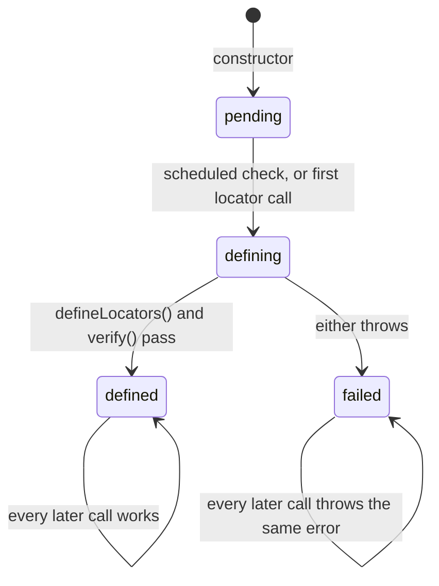

## Not in the constructor

A subclass's fields and constructor body run after `super(...)` returns. If `PageObject`'s constructor called
`defineLocators()`, the definition would see none of them: a locator named from a constructor argument would register
`undefined`, silently. So the constructor (`src/pageObject.ts`) prepares everything else and defers the definition:

1. It takes the label, the `label` option or the class name, and checks `baseUrl` and `urlPath`
   ([URL matching](/POMWright/internal/url-matching/)), throwing before anything else is created.
2. It builds `fullUrl`, the registry, the session storage helper and the navigation helper.
3. Last, after everything that can throw, it captures its [call site](/POMWright/internal/call-sites/) and schedules a
   check with `queueMicrotask`.

## Defined once, at the first chance

The definition runs once per page object, at whichever comes first:

- **the scheduled check**, a microtask that runs as soon as the code that called `new` has finished its synchronous
  part. In a fixture that is `await use(new LoginPage(page))`, before the test body starts;
- **the first locator call**: `add`, `getNestedLocator`, `getLocator`, `getLocatorSchema` or `verify`, from a field
  initialiser, a method, or the test.

`defineLocators()` itself calls `this.add(...)`, which is a locator call; while the state is `defining` it does not
start the definition again. Right after `defineLocators()`, `verify()` checks every registered path.

## The facade

The page object's `locatorRegistry`, `add`, `getLocator`, `getNestedLocator` and `getLocatorSchema` are not the
registry's own methods but wrappers that run the definition first. That covers every way into the registry, including
a locator module that receives `this.locatorRegistry`. `createReusable` is passed through unwrapped, since making a
seed registers nothing. `verify()` on the facade runs the definition, which verifies, or verifies again when the
definition has already run.

## Sticky, labelled failures

An error in `defineLocators()` or in the check after it is wrapped once, as
`LoginPage: defineLocators() failed: …` or `LoginPage: Locator registry verification failed …`, with the original as
`cause`, and kept: every later locator call throws the same error, and the definition never runs a second time, so a
half-registered page object can never be used. When the scheduled check finds the error, it throws it with the stack
of the construction site, so the report points at the line that created the page object, not at the microtask.

A page object built in a fixture therefore fails the fixture before the test body runs. One built in `beforeEach` or
`beforeAll` fails the tests the hook runs for, but the hook itself does not fail: each test body runs until its first
use of the page object, which throws the kept error again.

## No shared definition between instances

Each page object defines its own registry. A definition may depend on the instance, a locale or a variant passed to
the constructor, so sharing it between instances would be wrong for some page objects, and defining is cheap: about a
microsecond per path.
