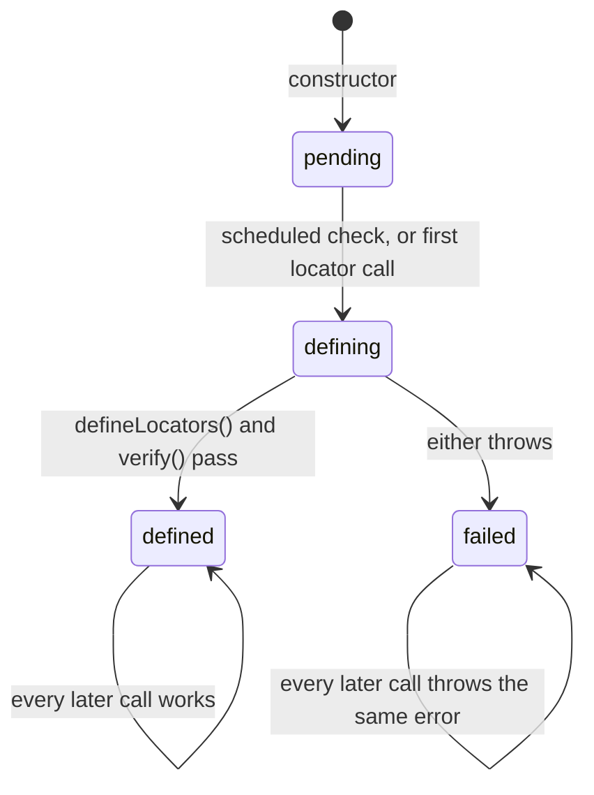

A page object registers its locators in `defineLocators()`, a method of the subclass. This page explains when that
method runs, why it cannot run in the constructor, and how a mistake in it is reported. How to write a page object is on
[Page objects](/POMWright/docs/page-objects/).

## Not in the constructor

A subclass's fields and constructor body run after `super(...)` returns. If `PageObject`'s constructor called
`defineLocators()`, the definition would see none of them: a locator named from a constructor argument would register
`undefined`, silently. So the constructor (`src/pageObject.ts`) prepares everything else and defers the definition:

1. It takes the label, the `label` option or the class name, and checks `baseUrl` and `urlPath`
   ([URL matching](/POMWright/internal/url-matching/)), throwing before anything else is created.
2. It builds `fullUrl`, the registry, the session storage helper and the navigation helper.
3. Last, after everything that can throw, it captures its [call site](/POMWright/internal/call-sites/) and schedules a
   check with `queueMicrotask`.

## Defined once, at the first chance

The definition runs once per page object, at whichever comes first:

- **the scheduled check**, a microtask that runs as soon as the code that called `new` has finished its synchronous
  part. In a fixture that is `await use(new LoginPage(page))`, before the test body starts;
- **the first locator call**: `add`, `getNestedLocator`, `getLocator`, `getLocatorSchema` or `verify`, from a field
  initializer, a method, or the test.

`defineLocators()` itself calls `this.add(...)`, which is a locator call; while the state is `defining` it does not
start the definition again. Right after `defineLocators()`, `verify()` checks every registered path.

## The facade

The page object's `locatorRegistry`, `add`, `getLocator`, `getNestedLocator` and `getLocatorSchema` are not the
registry's own methods but wrappers that run the definition first. That covers every way into the registry, including
a locator module that receives `this.locatorRegistry`. `createReusable` is passed through unwrapped, since making a
seed registers nothing. `verify()` on the facade runs the definition, which verifies, or verifies again when the
definition has already run.

## Sticky, labeled failures

An error in `defineLocators()` or in the check after it is wrapped once, as
`LoginPage: defineLocators() failed: …` or `LoginPage: Locator registry verification failed …`, with the original as
`cause`, and kept: every later locator call throws the same error, and the definition never runs a second time, so a
half-registered page object can never be used. When the scheduled check finds the error, it throws it with the stack
of the construction site, cut at the class the code constructed (`new.target`), so the report points at the line that
created the page object, not at the microtask, and not at the `super(…)` of a base class the project's page objects
share (see [call sites](/POMWright/internal/call-sites/#errors-raised-later)).

`defineLocators()` registers synchronously. TypeScript accepts an `async` override of a method that returns `void`,
and such a definition would be verified before the rest of it ran, while an error after its first `await` would escape
unlabeled and leave a half-registered page object. So a definition that returns a Promise (any value with a `then`
function) fails the page object at once, `LoginPage: defineLocators() must register its locators synchronously; …`,
kept like every other failure; the returned Promise's own rejection is handled, since that failure already reports it,
and the rest of the definition finds the kept failure at its next `add`.

The scheduled check cannot tell an instance whose subclass constructor threw after `super(…)` from one that was
returned: nothing reaches `PageObject` when a constructor below it throws. So the check runs on the abandoned instance
too, and fails the test with a second error. *Page objects* says to check the arguments before `super(…)` (see
[what the definition cannot see](/POMWright/docs/page-objects/#when-definelocators-runs)).

A page object built in a fixture therefore fails the fixture before the test body runs. One built in `beforeEach` or
`beforeAll` fails the tests the hook runs for, but the hook itself does not fail: each test body runs until its first
use of the page object, which throws the kept error again. One built in the test body, or in a `test.step` in it, fails
the test when the check's microtask throws, as Playwright fails a test on an uncaught error, but the body is not
stopped there: it runs on past the `await` that let the check run, until its next use of the page object throws the
kept error, or until the runner ends the test, which may add an error of its own to a Playwright call in flight.

## No shared definition between instances

Each page object defines its own registry. A definition may depend on the instance, a locale or a variant passed to
the constructor, so sharing it between instances would be wrong for some page objects, and defining is cheap: a few
microseconds per path (see [Performance](/POMWright/internal/performance/)).

## Alternatives weighed

- **Defining at the first locator call only.** It would move every registry mistake to the first use, often inside a
  test, and never check a page object a test does not use.
- **An explicit `init()` or a static `create()`.** Boilerplate in every fixture, and a forgotten call fails silently.
- **Defining in the constructor, with a warning in the docs.** The definition would still read `undefined` for every
  value the subclass sets, and nothing would report it.
- **A getter for `locatorRegistry`.** It would run the definition on any read, and a subclass that declares the member
  again fails to compile (TS2610).
- **Awaiting an `async` definition.** It would make the lifecycle asynchronous, against builders that are synchronous,
  and every locator call would have to wait for it.
- **`defineLocators()` typed to return `undefined`.** TypeScript would refuse an `async` definition, but the docs write
  `protected defineLocators(): void {`, and that code would stop compiling.

The lifecycle state is an ECMAScript `#private` member, `#locators`, rather than a TypeScript `private` one: `PageObject`
is the class users extend, and a TypeScript-private name is a real property that a subclass member of the same name
would collide with.
