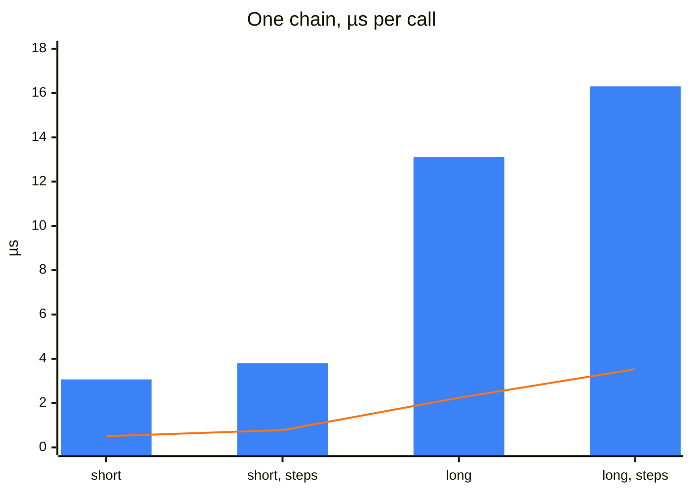
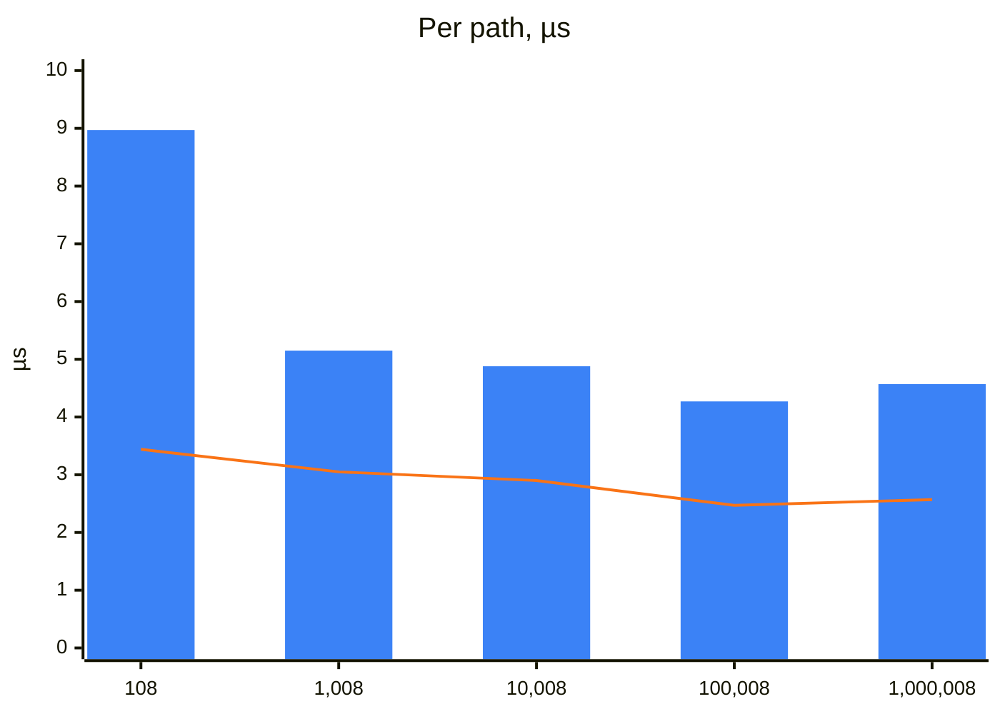
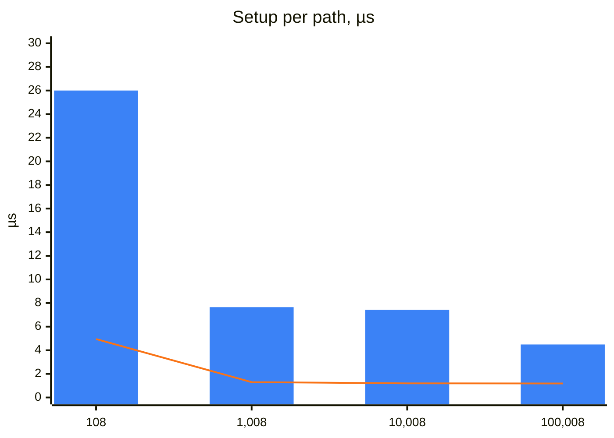
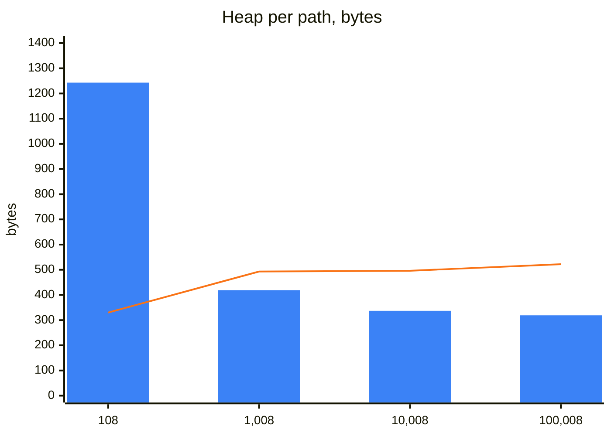

Every locator a test acts on goes through the registry: it is registered once per page object and resolved at every
use. This page measures what that costs, in time and in memory, beside the same work done with Playwright alone. How
resolution works is on [Resolution](/POMWright/internal/resolution/).

In short: in a real suite the difference is too small to notice. POMWright adds microseconds per locator and about two
milliseconds per page object of a hundred paths, where a single round trip to the browser takes about a millisecond and
a test takes seconds; only page objects with tens of thousands of paths, built for every test, add tens of
milliseconds.

## Basis for testing

`scripts/benchmark.mjs` measures the installed package, the build npm would publish, on a chromium page. Run it with
`pnpm bench` after `pnpm harness:install`; it prints the tables below.

- **Four kinds of path.** A short path has 3 segments and a long one 12, with a `main` landmark, then sections, then a
  button. A plain path has only definitions; the other kind adds one filter step to every segment. Every segment is
  registered, so a chain has one Playwright locator per segment.
- **The Playwright baseline** builds the same chain directly, such as
  `page.locator("main").getByRole("region", { name: "Section 1" }).getByRole("button", { name: "Save" })`.
- **Per call**, each measurement runs its call 20,000 times (registration, which builds a fresh registry for each call,
  2,000 times), after a warm-up run of the same size, and takes the median of 7 runs, timed with `process.hrtime`.
  Registration is measured per chain and divided by its segments.
- **At scale**, a registry holds a mix of the four kinds, from about 100 to about 1,000,000 paths. Registration,
  `verify()`, and a page object's `defineLocators()` with its `verify()` are timed as one run each, the median of 5 runs
  up to 10,000 paths. The heap is read after a garbage collection, before and after registration.
- **As a fixture**, `test/benchmarks/pageObjectFixture.spec.ts` sets up two page objects with the same mix of paths in
  the Playwright runner (`test/playwright.bench.config.ts`, chromium, one worker, each case 5 times): a POMWright page
  object, and one written with Playwright alone, which builds one `Locator` field per path in its constructor, each from
  its parent's field (`this.form = this.main.getByRole(…)`). Each fixture times `new` up to the end of the microtask
  that a fixture's `await use()` gives it, when a POMWright page object has run `defineLocators()` and `verify()`, and
  reads the heap after a garbage collection, before and after.

Measured 2026-10-28 at e571381 with Node v24.22.0, Playwright 1.64.0, on a 13th Gen Intel Core i9-13980HX under Linux.
On the same machine, two runs of this code agreed within about 12% everywhere but the smallest measurements: the
108-path rows, one run of a fraction of a millisecond, and the registration of the shortest chain, about a microsecond,
differed by up to 50%. Against the numbers measured before this release's fixes (2026-10-22, 61e266c), no column moved
more than the Playwright baseline did between the two days (up to 19%): no change of the code shows above that spread,
the path check `add` now makes, estimated at 30 to 90 ns per path, included.

## Results

### Resolving one path

| path | Playwright chain | `getNestedLocator` | `getLocator` | query, `getNestedLocator()` | registration, per path |
| --- | --- | --- | --- | --- | --- |
| short, plain (3 segments) | 0.504 µs | 3.07 µs | 1.49 µs | 3.09 µs | 1.29 µs |
| short, a step per segment (3 segments) | 0.781 µs | 3.80 µs | 1.76 µs | 3.89 µs | 1.67 µs |
| long, plain (12 segments) | 2.24 µs | 13.1 µs | 3.69 µs | 13.1 µs | 1.04 µs |
| long, a step per segment (12 segments) | 3.53 µs | 16.3 µs | 4.12 µs | 16.6 µs | 1.81 µs |

The blue bars are `getNestedLocator`, the orange line the same chain built with Playwright.

### A registry at scale

| registered paths | registration | `verify()` | page object: `defineLocators()` and `verify()` | heap |
| --- | --- | --- | --- | --- |
| 108 | 0.287 ms | 0.372 ms | 0.969 ms | 0.025 MB |
| 1,008 | 2.01 ms | 3.07 ms | 5.19 ms | 0.263 MB |
| 10,008 | 17.6 ms | 29.0 ms | 48.8 ms | 2.78 MB |
| 100,008 | 193 ms | 247 ms | 427 ms | 31.4 MB |
| 1,000,008 | 2.10 s | 2.57 s | 4.57 s | 308 MB |

The blue bars are a page object's `defineLocators()` and `verify()`, the orange line `verify()` alone, each divided by the number
of paths: the cost per path stays flat from 1,000 paths to 1,000,000.

### A page object as a fixture

| paths | written with Playwright: setup | heap | POMWright: setup, `defineLocators()` and `verify()` | heap |
| --- | --- | --- | --- | --- |
| 108 | 0.535 ms | 0.034 MB | 2.81 ms | 0.128 MB |
| 1,008 | 1.31 ms | 0.474 MB | 7.71 ms | 0.403 MB |
| 10,008 | 12.0 ms | 4.73 MB | 74.3 ms | 3.22 MB |
| 100,008 | 119 ms | 49.8 MB | 449 ms | 30.4 MB |

The blue bars are the POMWright page object, the orange line the one written with Playwright, each divided by the number of paths.
At 108 paths the heap is a fraction of a megabyte and within the noise.

## Conclusion

In practice, a suite written with POMWright runs as fast as one written with Playwright alone. Every difference
measured here is in microseconds per locator, or milliseconds per page object, while a test spends its time in the
browser: navigations, page loads, the application's scripts and Playwright's waits. The details:

- **Resolving costs about 1 µs per segment.** `getNestedLocator` on a 3-segment path takes about 3 µs, on 12 segments
  about 13 µs, five to six times what building the same chain by hand takes. The difference is the work of the
  registry: checking the path, copying the records of the chain, and describing the result.
- **`getLocator` builds one locator,** the path's own, so its cost hardly grows with the path's length.
- **A query costs the same as `getNestedLocator`,** which starts a query itself.
- **A page object is ready in about a millisecond.** Registration takes 1 to 2 µs per path, and `verify()` about
  3 µs. A page object of 100 paths defines and verifies its locators in about 1 ms; 10,000 paths take about 50 ms.
- **Everything grows linearly** with the number of paths, for the registries measured here, whose filters are text
  filters; a filter that names another path resolves that path as well, at each resolution and in `verify()`. A
  registered path takes about 300 bytes of heap.
- **As a fixture, a POMWright page object takes four to six times as long to set up** as one written with Playwright:
  2.8 ms against 0.5 ms for about 100 paths, 0.45 s against 0.12 s for 100,000. The page object written by hand has
  built every locator by then; a POMWright page object builds a locator at each use instead, for the 1.5 to 17 µs of
  the first table.
- **It takes less memory from 1,000 paths up:** about 30 MB against 50 MB for 100,000 paths. A record holds a path, a
  definition and its steps, where a Playwright `Locator` holds its whole selector chain.

For scale: on the same machine, one `count()` of a locator on a small page, the cheapest round trip to the browser,
took between about 370 and 710 µs, the median of 200 calls in each of five runs. Resolving the longest chain measured
here costs under 5% of that. A page object of about 100 paths defines and verifies its locators in the time of one to
three such round trips (1.0 ms), and is set up as a fixture in that of four to eight (2.8 ms).

## Limitations

A benchmark measures what it isolates, under the conditions it was run in, so read the numbers as an order of
magnitude rather than as what a suite will see:

- **Only the work in Node is measured.** Building a locator talks to no browser; finding the element is the browser's
  work, at the first action, and is the same for a chain POMWright built and one written by hand.
- **Real tests spend their time elsewhere.** Navigations, page loads, the application's own scripts, network requests,
  animations and Playwright's waiting for an element to be ready take milliseconds to seconds per step, and they decide
  how long a test takes.
- **The paths are made up.** Real paths vary in length and in what they register; a mix of real page objects will not
  match these four kinds exactly.
- **The machine matters.** Another CPU, another Node version or other load on the machine gives other numbers, and the
  just-in-time compiler and the garbage collector make single measurements vary; the medians smooth that, but do not
  remove it.

To compare a change, run `pnpm bench` before and after it on the same machine.
