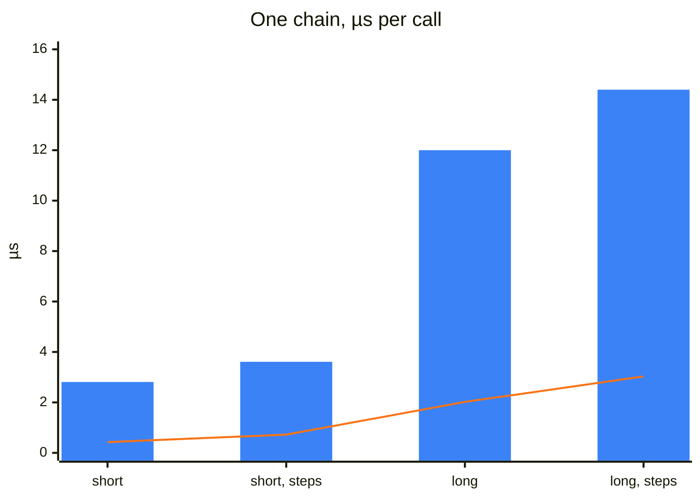
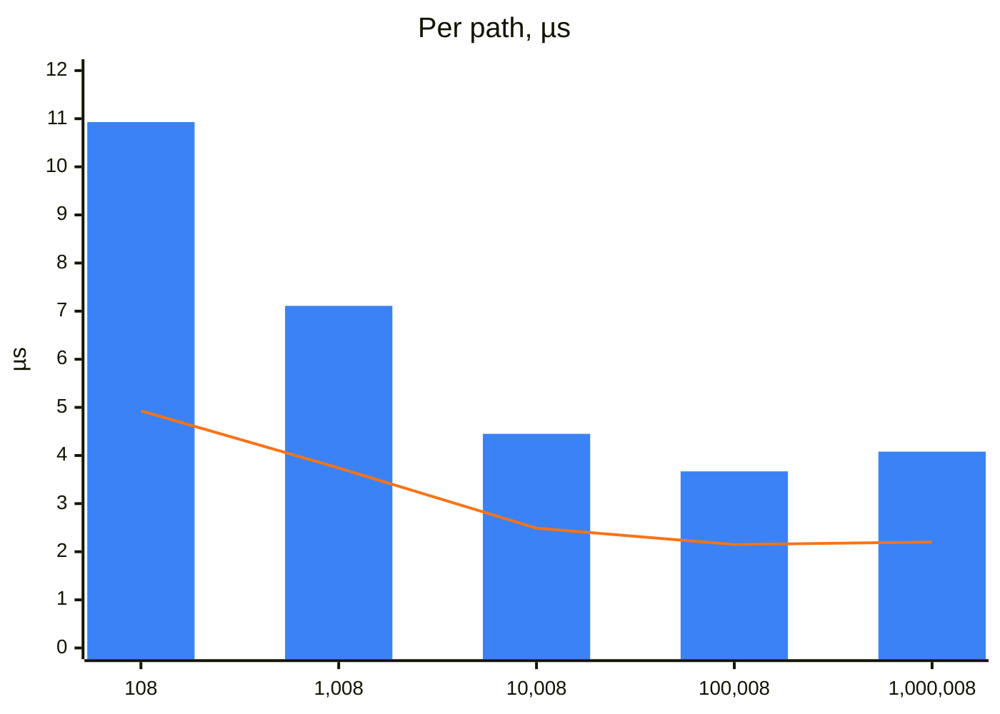
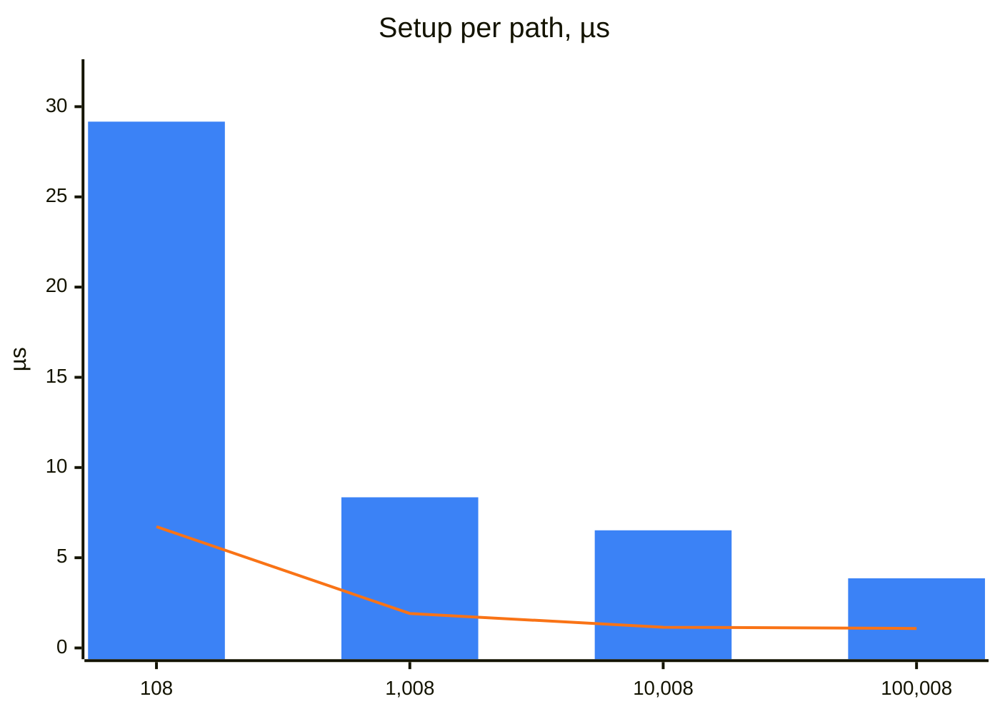
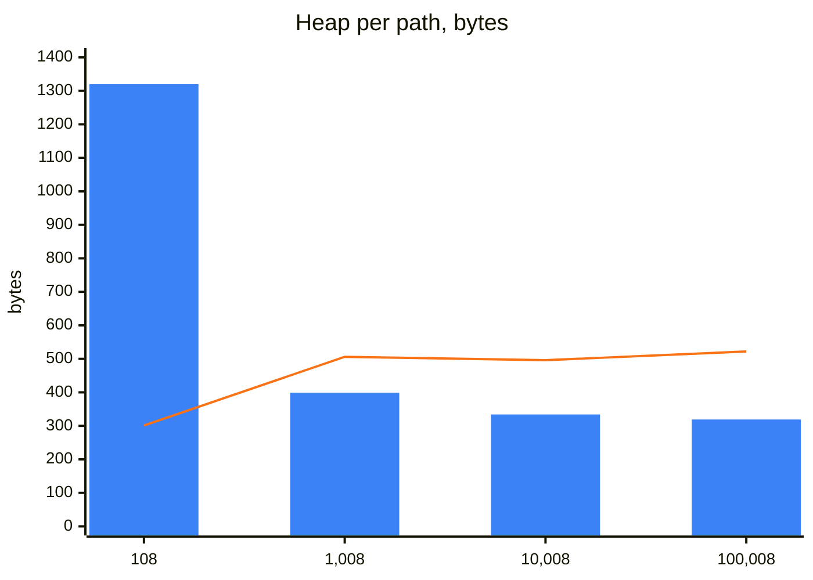

Every locator a test acts on goes through the registry: it is registered once per page object and resolved at every
use. Every session storage call goes through Playwright's `page.sessionStorage`, with POMWright's checks around it.
This page measures what that costs, in time and in memory, beside the same work done with Playwright alone. How
resolution works is on [Resolution](/POMWright/internal/resolution/), and the checks around a storage call on
[Seed registry](/POMWright/internal/seed-registry/#the-origin-around-every-call).

In short: in a real suite the difference is too small to notice. POMWright adds microseconds per locator and about
three milliseconds per page object of a hundred paths set up as a fixture, where a single round trip to the browser
takes about a third of a millisecond and a test takes seconds; only page objects with tens of thousands of paths,
built for every test, add tens of milliseconds. A session storage call of several keys takes about twice what the same
Playwright calls take, and one of a single key about four times: milliseconds either way.

## Basis for testing

`scripts/benchmark.mjs` measures the installed package, the build npm would publish. Run it with `pnpm bench` after
`pnpm harness:install`; it prints the tables below, in three sections that `pnpm bench registry fixture storage` names.
Each section runs five times in fresh processes, and every cell is the median of the five with their range: a
process's compiled code, its heap and the cores it lands on differ from one run to the next.

- **Four kinds of path.** A short path has 3 segments and a long one 12, with a `main` landmark, then sections, then a
  button. A plain path has only definitions; the other kind adds one filter step to every segment. Every segment is
  registered, so a chain has one Playwright locator per segment.
- **The Playwright baseline** builds the same chain directly, such as
  `page.locator("main").getByRole("region", { name: "Section 1" }).getByRole("button", { name: "Save" })`, through
  the same segment data the registry gets, so with dynamic calls a little slower than the code written out.
- **Per call**, on a chromium page, each measurement runs its call 20,000 times (registration 2,000 times, each into a
  fresh registry built before the timer starts), after every kind's calls have run once, so no kind is measured on code
  compiled for fewer kinds than the others. It takes the median of 7 runs, each after a garbage collection, timed with
  `process.hrtime`, and keeps every result, so the work cannot be dropped. Registration is measured per chain and
  divided by its segments.
- **At scale**, a registry holds a mix of the four kinds, from about 100 to about 1,000,000 paths. Registration,
  `verify()`, and a page object's `defineLocators()` with its `verify()` are timed as one run each, the median of 5
  runs up to 10,000 paths. The heap is read after a garbage collection, before and after registration.
- **For scale**, one `count()` of a locator on a small page, a round trip to the browser: 500 calls to warm up, then
  the median of 200 calls in each of five runs.
- **As a fixture**, `test/benchmarks/pageObjectFixture.spec.ts` sets up two page objects with the same mix of paths in
  the Playwright runner (`test/playwright.bench.config.ts`, chromium, one worker, each case 5 times per run): a
  POMWright page object, and one written with Playwright alone, which builds one `Locator` field per path in its
  constructor, each from its parent's field (`this.form = this.main.getByRole(…)`). Each fixture times `new` up to the
  end of the microtask that a fixture's `await use()` gives it, when a POMWright page object has run `defineLocators()`
  and `verify()`, and reads the heap after a garbage collection, before and after.
- **Session storage**, `test/benchmarks/sessionStorage.spec.ts`, on the test server's pages in chromium, firefox and
  webkit: `set`, `get` and `clear` of 1, 10 and 100 keys, with values of 10 and 1,000 characters, each beside the
  fewest `page.sessionStorage` calls that do the same storage work, awaited in turn as a test would write them (`set`
  beside one `setItem` per key, `get(keys)` beside one `getItem` per key, `get()` beside `items()`, `clear(keys)`
  beside one `removeItem` per key, `clear()` beside `clear()`), and beside a build without the document check
  (`c7d998c`), the commit before every storage call began checking, after each key, that its document is still the one
  it started in. `seed` of 10 and 100 keys is timed at the call and at the arrival, the `page.goto()` to the seeded
  origin, beside two init scripts written by hand: one that writes the entries when `location.origin` is the origin,
  and one that also writes only on the first arrival there. The quota: values of 100,000 characters until the browser
  refuses one, then `set` of 90% of what fitted beside as many `setItem` calls. Each case is a test of its own, the
  median of 10 calls after 3 to warm up, in five copies: Playwright records every call of a test as a step, and a call
  costs more the more steps its test already has, so one test holding every case would charge the later ones for the
  earlier ones. It runs at rest, on one worker, and under the harness's parallel workers: half the CPUs the process may
  use, as the harness's "50%" is half a machine's, here 2 workers on 4 CPUs, as on CI's runner.

Measured 2026-10-30 at 649d903 with Node v24.22.0, Playwright 1.64.0, on a 13th Gen Intel Core i9-13980HX under Linux,
pinned to its CPUs 0 to 3, two of its eight performance cores with two threads each (`taskset -c 0-3 pnpm bench`); the
load average was 1.40 at the start. A second run of the whole benchmark differed from this one by 1.8% in the median
cell of the locator tables (12% at most) and by 3.0% in the median cell of the storage tables, where WebKit's arrival
under load moved most. Unpinned, on all 32 CPUs, fast and slow cores alike, the storage calls spread far wider, their
range 54% of the median in the median cell at rest against 9% pinned; the locator tables spread less (5% against
13%): pinned, the registries of 10,000 paths and more varied most, their slowest run up to 60% above the median.

## Results

### Resolving one path

| path | Playwright chain | `getNestedLocator` | `getLocator` | query, `getNestedLocator()` | registration, per path |
| --- | --- | --- | --- | --- | --- |
| short, plain (3 segments) | 0.426 µs (0.404–0.453) | 2.81 µs (2.78–3.34) | 1.31 µs (1.27–1.46) | 2.89 µs (2.78–3.21) | 0.955 µs (0.918–1.28) |
| short, a step per segment (3 segments) | 0.721 µs (0.693–0.761) | 3.61 µs (3.49–4.04) | 1.55 µs (1.48–1.68) | 3.54 µs (3.49–4.02) | 1.97 µs (1.85–2.31) |
| long, plain (12 segments) | 2.02 µs (1.99–2.18) | 12.0 µs (11.4–13.8) | 3.26 µs (3.18–3.70) | 11.7 µs (11.5–13.9) | 1.00 µs (0.988–1.46) |
| long, a step per segment (12 segments) | 3.03 µs (2.89–3.29) | 14.4 µs (13.8–15.7) | 3.59 µs (3.42–3.83) | 14.6 µs (14.1–16.2) | 1.73 µs (1.64–2.41) |

The blue bars are `getNestedLocator`, the orange line the same chain built with Playwright. Creating a registry takes
0.059 µs (0.057–0.070).

### A registry at scale

| registered paths | registration | `verify()` | page object: `defineLocators()` and `verify()` | heap |
| --- | --- | --- | --- | --- |
| 108 | 0.349 ms (0.314–0.451) | 0.532 ms (0.501–0.546) | 1.18 ms (1.10–1.19) | 0.026 MB (0.024–0.027) |
| 1,008 | 3.07 ms (2.93–3.14) | 3.77 ms (2.89–4.06) | 7.17 ms (5.94–7.40) | 0.264 MB (0.255–0.268) |
| 10,008 | 17.3 ms (16.8–27.4) | 24.9 ms (23.6–30.8) | 44.5 ms (44.0–60.0) | 2.79 MB (2.79–2.80) |
| 100,008 | 162 ms (161–194) | 215 ms (199–231) | 367 ms (356–503) | 31.4 MB (31.4–31.4) |
| 1,000,008 | 1.80 s (1.74–2.25) | 2.20 s (2.19–3.12) | 4.08 s (4.04–5.41) | 308 MB (308–308) |

The blue bars are a page object's `defineLocators()` and `verify()`, the orange line `verify()` alone, each divided by
the number of paths: the cost per path falls as a registry grows and stays flat from 10,000 paths to 1,000,000.

### A page object as a fixture

| paths | written with Playwright: setup | heap | POMWright: setup, `defineLocators()` and `verify()` | heap |
| --- | --- | --- | --- | --- |
| 108 | 0.726 ms (0.713–0.746) | 0.031 MB (0.029–0.033) | 3.15 ms (3.12–3.19) | 0.136 MB (0.134–0.140) |
| 1,008 | 1.93 ms (1.91–1.98) | 0.486 MB (0.482–0.492) | 8.42 ms (8.18–8.50) | 0.384 MB (0.382–0.407) |
| 10,008 | 11.5 ms (11.3–11.8) | 4.73 MB (4.73–4.73) | 65.3 ms (63.4–68.0) | 3.19 MB (3.19–3.19) |
| 100,008 | 108 ms (108–111) | 49.8 MB (49.8–49.8) | 386 ms (378–390) | 30.4 MB (30.4–30.4) |

The blue bars are the POMWright page object, the orange line the one written with Playwright, each divided by the number of paths.
At 108 paths the heap is a fraction of a megabyte.

### Session storage

Each cell is milliseconds per call, at rest, with values of 1,000 characters; values of 10 characters gave about the
same (`set` of 100 keys on chromium: 61.6 ms against 59.4 ms).

#### chromium

| call | keys | POMWright | Playwright's calls | without the document check |
| --- | --- | --- | --- | --- |
| `set` | 1 | 1.56 ms (1.53–1.63) | 0.355 ms (0.344–0.364) | 0.537 ms (0.504–0.539) |
| `set` | 10 | 7.29 ms (7.15–7.32) | 3.30 ms (2.93–3.34) | 3.33 ms (3.22–3.37) |
| `set` | 100 | 59.4 ms (59.0–59.7) | 31.6 ms (31.3–32.5) | 29.3 ms (28.3–29.8) |
| `get(keys)` | 1 | 1.50 ms (1.48–1.62) | 0.325 ms (0.267–0.476) | 0.568 ms (0.474–0.606) |
| `get(keys)` | 10 | 5.20 ms (4.99–5.38) | 3.44 ms (3.30–3.71) | 2.13 ms (2.05–2.24) |
| `get(keys)` | 100 | 37.3 ms (37.0–37.9) | 26.8 ms (26.4–27.1) | 18.4 ms (17.1–19.1) |
| `get()` | 100 | 2.47 ms (2.40–2.51) | 1.38 ms (1.34–1.42) | 1.52 ms (1.47–1.53) |
| `clear(keys)` | 1 | 1.45 ms (1.39–1.51) | 0.363 ms (0.343–0.402) | 0.542 ms (0.527–0.618) |
| `clear(keys)` | 10 | 6.89 ms (6.64–7.30) | 3.17 ms (3.04–3.26) | 3.12 ms (3.02–3.16) |
| `clear(keys)` | 100 | 54.9 ms (54.0–57.4) | 28.6 ms (27.0–30.4) | 26.2 ms (25.4–26.4) |
| `clear()` | 100 | 1.36 ms (1.31–1.40) | 0.355 ms (0.342–0.373) | 0.527 ms (0.522–0.552) |

#### firefox

| call | keys | POMWright | Playwright's calls | without the document check |
| --- | --- | --- | --- | --- |
| `set` | 1 | 1.95 ms (1.88–2.03) | 0.445 ms (0.418–0.496) | 0.658 ms (0.602–0.682) |
| `set` | 10 | 9.49 ms (9.23–10.1) | 4.17 ms (3.78–4.26) | 4.57 ms (4.05–5.12) |
| `set` | 100 | 74.5 ms (73.4–77.9) | 39.1 ms (37.6–39.6) | 35.7 ms (35.3–38.0) |
| `get(keys)` | 1 | 1.93 ms (1.84–1.98) | 0.399 ms (0.368–0.526) | 0.591 ms (0.552–0.623) |
| `get(keys)` | 10 | 6.38 ms (6.03–6.96) | 4.24 ms (4.20–4.54) | 2.64 ms (2.48–2.91) |
| `get(keys)` | 100 | 41.8 ms (40.5–42.0) | 37.5 ms (36.9–39.0) | 21.0 ms (19.8–21.6) |
| `get()` | 100 | 3.96 ms (3.86–4.03) | 2.50 ms (2.43–2.53) | 2.71 ms (2.66–2.77) |
| `clear(keys)` | 1 | 1.84 ms (1.75–1.92) | 0.461 ms (0.447–0.488) | 0.617 ms (0.607–0.645) |
| `clear(keys)` | 10 | 9.25 ms (9.13–9.51) | 4.29 ms (3.87–4.38) | 4.18 ms (3.97–4.41) |
| `clear(keys)` | 100 | 73.3 ms (71.4–74.5) | 38.4 ms (37.9–39.4) | 34.5 ms (33.0–39.3) |
| `clear()` | 100 | 1.82 ms (1.76–1.89) | 0.507 ms (0.476–0.586) | 0.780 ms (0.661–0.822) |

#### webkit

| call | keys | POMWright | Playwright's calls | without the document check |
| --- | --- | --- | --- | --- |
| `set` | 1 | 1.68 ms (1.65–1.88) | 0.390 ms (0.353–0.401) | 0.564 ms (0.517–0.664) |
| `set` | 10 | 6.83 ms (6.72–7.26) | 2.91 ms (2.89–3.08) | 2.96 ms (2.88–3.11) |
| `set` | 100 | 57.8 ms (56.7–58.4) | 29.8 ms (28.3–30.6) | 28.1 ms (26.1–28.3) |
| `get(keys)` | 1 | 1.61 ms (1.49–1.93) | 0.410 ms (0.288–0.422) | 0.516 ms (0.507–0.565) |
| `get(keys)` | 10 | 5.50 ms (5.16–5.56) | 3.31 ms (2.57–4.00) | 2.10 ms (2.04–2.20) |
| `get(keys)` | 100 | 39.4 ms (38.9–40.2) | 22.6 ms (22.5–23.7) | 18.0 ms (17.7–19.3) |
| `get()` | 100 | 2.45 ms (2.33–2.50) | 1.28 ms (1.25–1.40) | 1.43 ms (1.42–1.53) |
| `clear(keys)` | 1 | 1.58 ms (1.51–1.66) | 0.403 ms (0.388–0.445) | 0.580 ms (0.578–0.588) |
| `clear(keys)` | 10 | 6.41 ms (6.32–6.45) | 3.12 ms (2.96–3.25) | 2.97 ms (2.83–3.09) |
| `clear(keys)` | 100 | 53.3 ms (52.7–54.1) | 27.2 ms (26.1–27.8) | 25.0 ms (22.8–25.9) |
| `clear()` | 100 | 1.50 ms (1.46–1.57) | 0.438 ms (0.430–0.531) | 0.597 ms (0.572–0.651) |

#### Under the harness's parallel workers

Two workers on the same 4 CPUs, 100 keys of 1,000 characters:

| browser | call | POMWright | Playwright's calls | without the document check |
| --- | --- | --- | --- | --- |
| chromium | `set` | 87.0 ms (86.1–107) | 45.1 ms (44.6–48.4) | 42.5 ms (40.8–45.7) |
| chromium | `get(keys)` | 51.0 ms (49.9–54.1) | 42.9 ms (42.0–44.9) | 24.6 ms (23.8–26.0) |
| chromium | `clear(keys)` | 83.6 ms (83.0–89.2) | 44.4 ms (42.7–60.4) | 41.3 ms (40.4–43.5) |
| firefox | `set` | 123 ms (120–129) | 59.9 ms (53.5–61.4) | 78.0 ms (59.5–86.3) |
| firefox | `get(keys)` | 55.7 ms (54.2–58.8) | 68.3 ms (65.7–79.1) | 30.2 ms (26.8–37.1) |
| firefox | `clear(keys)` | 138 ms (119–157) | 64.5 ms (60.0–70.7) | 72.6 ms (57.4–83.8) |
| webkit | `set` | 93.9 ms (59.7–96.3) | 50.6 ms (28.7–52.3) | 44.7 ms (27.2–47.5) |
| webkit | `get(keys)` | 52.4 ms (39.4–64.6) | 46.7 ms (22.6–48.0) | 24.9 ms (17.9–26.5) |
| webkit | `clear(keys)` | 92.0 ms (52.8–94.0) | 46.1 ms (26.3–49.3) | 42.7 ms (23.4–46.1) |

#### seed

The call, on the first origin, with keys of 1,000 characters, beside the call of each init script:

| browser | keys | `seed` | origin script | first-arrival script |
| --- | --- | --- | --- | --- |
| chromium | 10 | 1.58 ms (1.52–2.03) | 1.37 ms (1.27–1.45) | 1.33 ms (1.12–1.48) |
| chromium | 100 | 3.34 ms (3.15–3.92) | 2.88 ms (2.30–3.10) | 2.55 ms (2.39–3.48) |
| firefox | 10 | 2.22 ms (2.13–2.37) | 1.86 ms (1.71–2.10) | 1.81 ms (1.71–2.02) |
| firefox | 100 | 2.43 ms (2.35–2.49) | 2.16 ms (2.01–2.19) | 2.11 ms (1.99–2.23) |
| webkit | 10 | 2.00 ms (1.72–2.09) | 1.34 ms (1.09–1.70) | 1.55 ms (1.39–1.70) |
| webkit | 100 | 2.43 ms (2.20–2.60) | 2.13 ms (2.06–2.17) | 2.13 ms (2.08–2.26) |

The arrival, the `page.goto()` to the seeded origin's page:

| browser | keys | `seed` | origin script | first-arrival script | no seed |
| --- | --- | --- | --- | --- | --- |
| chromium | 10 | 17.0 ms (16.9–17.1) | 16.4 ms (16.1–17.4) | 16.6 ms (16.3–16.7) | 16.3 ms (16.1–16.3) |
| chromium | 100 | 23.7 ms (23.0–25.5) | 24.0 ms (23.3–24.3) | 23.9 ms (22.8–24.9) | 16.1 ms (15.7–16.5) |
| firefox | 10 | 10.3 ms (9.65–11.0) | 10.3 ms (9.29–10.4) | 10.5 ms (9.45–11.0) | 10.2 ms (9.05–11.1) |
| firefox | 100 | 18.2 ms (17.2–19.1) | 18.7 ms (17.4–19.8) | 18.3 ms (16.9–18.9) | 10.7 ms (9.12–11.5) |
| webkit | 10 | 48.6 ms (46.0–58.3) | 42.1 ms (40.2–50.3) | 41.6 ms (40.1–55.0) | 42.3 ms (40.2–45.7) |
| webkit | 100 | 42.8 ms (41.0–44.4) | 44.2 ms (43.5–45.1) | 45.1 ms (43.4–45.8) | 56.0 ms (42.2–67.4) |

What the scripts written by hand leave out, and `seed` does: write only in the main frame, and only into a document
whose own origin is the seeded one (never a browser's error page); remove itself once the main frame commits on the
origin; report a write the browser refused; fail the test when the seed was never applied, at the line that called
`seed`; and take its turn among the page's other storage calls.

#### The quota

| browser | characters the origin held, keys and values | `set` of 46 values of 100,000 characters | as many `setItem` calls |
| --- | --- | --- | --- |
| chromium | 5,200,146 | 83.6 ms (82.1–86.9) | 69.7 ms (68.3–71.8) |
| firefox | 5,200,146 | 74.5 ms (71.5–82.7) | 70.5 ms (52.2–77.8) |
| webkit | 5,200,146 | 61.7 ms (60.5–62.3) | 45.8 ms (44.4–46.0) |

Every browser took 52 values of 100,000 characters and refused the 53rd, which would have passed 5,242,880 characters.

## Conclusion

In practice, a suite written with POMWright runs as fast as one written with Playwright alone. Every difference
measured here is in microseconds per locator, milliseconds per page object or per storage call, while a test spends its
time in the browser: navigations, page loads, the application's scripts and Playwright's waits. The details:

- **Resolving costs about 1 µs per segment.** `getNestedLocator` on a 3-segment path takes about 3 µs, on 12 segments
  about 12 µs, five to seven times what building the same chain by hand takes (4.7 to 6.9 in the runs). The difference
  is the work of the registry: checking the path, copying the records of the chain, and describing the result.
- **`getLocator` builds one locator,** the path's own, so its cost hardly grows with the path's length.
- **A query costs the same as `getNestedLocator`,** which starts a query itself.
- **A page object is ready in about a millisecond.** Registration takes 1 to 3 µs per path, and `verify()` 2 to 5 µs. A
  page object of 100 paths defines and verifies its locators in about 1.2 ms; 10,000 paths take about 45 ms.
- **Everything grows linearly** with the number of paths, for the registries measured here, whose filters are text
  filters; a filter that names another path resolves that path as well, at each resolution and in `verify()`. A
  registered path takes about 300 bytes of heap.
- **As a fixture, a POMWright page object takes 3.5 to 6 times as long to set up** as one written with Playwright:
  3.2 ms against 0.7 ms for about 100 paths, 0.39 s against 0.11 s for 100,000. The page object written by hand has
  built every locator by then; a POMWright page object builds a locator at each use instead, for the 1.3 to 15 µs of
  the first table.
- **It takes less memory from 1,000 paths up:** about 30 MB against 50 MB for 100,000 paths. A record holds a path, a
  definition and its steps, where a Playwright `Locator` holds its whole selector chain.
- **A session storage call takes about twice what Playwright's calls take for the same keys,** in all three browsers:
  `set` of 100 keys 58 to 75 ms against 30 to 39 ms. The difference is the document check, one more round trip after
  every key: without it, calls of 10 keys and more cost about what Playwright's do. A call of one key takes 1.5 to
  2 ms, against 0.3 to 0.5 ms: besides its key, it takes, checks and releases a handle to its document, three more
  round trips, inside a step of its own. Under the harness's parallel workers every call takes longer, and the ratios
  stay about the same.
- **`get()` and `clear()` are one storage call each,** however many keys: 1.4 to 4 ms for 100.
- **Without the check, reads took less than Playwright's own calls** (`get(keys)` of 100 keys on chromium: 18.4 ms
  against 26.8 ms): Playwright records a call made in the test body as a step of its own, which costs more than a call
  inside a step, where POMWright makes them.
- **`seed` costs at the call a few tenths of a millisecond more than an init script written by hand.** At the arrival
  it costs what the scripts do on chromium and firefox, where writing 100 entries adds 8 to 10 ms to an arrival
  through `seed` as through either script. WebKit's arrivals vary by about 15 ms from one to the next: there the
  median of 10 keys came out 0 to 15 ms above the scripts' in three runs of the benchmark, and that of 100 keys within
  their range.
- **Each browser held 52 values of 100,000 characters,** within the 5,242,880 characters per origin that
  [Session storage](/POMWright/docs/session-storage/#size-and-cost) gives; `set` fills 90% of that in 62 to 84 ms.

For scale: on the same machine, one `count()` of a locator on a small page took 313 µs (286 to 335), the median of five
runs. Resolving the longest chain measured here costs about 5% of that (4.3% to 5.0%). A page object of about 100
paths defines and verifies its locators in the time of about four such round trips (1.18 ms), and is set up as a
fixture in that of about ten (3.15 ms). A storage call of one key takes five or six.

## Limitations

A benchmark measures what it isolates, under the conditions it was run in, so read the numbers as an order of
magnitude rather than as what a suite will see:

- **The locator tables measure only the work in Node.** Building a locator talks to no browser; finding the element is
  the browser's work, at the first action, and is the same for a chain POMWright built and one written by hand. The
  storage tables include the browser, which does the same storage work for both.
- **Real tests spend their time elsewhere.** Navigations, page loads, the application's own scripts, network requests,
  animations and Playwright's waiting for an element to be ready take milliseconds to seconds per step, and they decide
  how long a test takes.
- **The paths are made up.** Real paths vary in length and in what they register; a mix of real page objects will not
  match these four kinds exactly.
- **Playwright's calls are measured as a test writes them,** in the test body, where each is a step of its own; inside
  a step of the test's own, they cost less.
- **The machine matters.** Another CPU, another Node version or other load on the machine gives other numbers; which
  cores a process runs on matters on a CPU with fast and slow cores, which is why these were pinned. The just-in-time
  compiler and the garbage collector make single measurements vary; the medians smooth that, and the ranges show what
  is left.

To compare a change, run `pnpm bench` before and after it on the same machine, under the same `taskset` if any.
