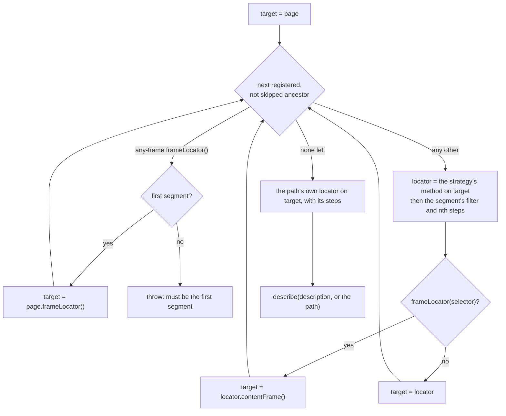

Resolution turns the records of a path's segments into one Playwright `Locator`. This page explains how the chain is
built, why `has` paths and frames resolve as they do, and what `verify()` can and cannot find. How to resolve a path is
on [Resolving locators](/POMWright/docs/resolving-locators/).

## The chain

Every resolution goes through one method, `buildLocatorChain` in `src/locators/locatorRegistry.ts`. It takes the path,
the path's own definition, the definitions and steps of the segments to include, the segments a query skips, and the
description:



- **Segments.** The ancestors are the path's prefixes (`main` and `main.form` of `main.form.submit`) that have a
  record. An unregistered prefix is a name that groups paths and is left out; with `strictChains`, `verify()` requires
  every one to be registered. A query's `skip` leaves a registered one out for that query.
- **Locators.** Each segment's locator is created on the one before it, by the method the
  [strategy table](/POMWright/internal/strategies-table/) names for its definition: `target.getByRole(role, options)`,
  `target.locator(selector, options)`, and so on.
- **Steps.** A segment's steps follow its locator in the order chained: a filter step calls `locator.filter()`, an
  index step `first()`, `last()` or `nth(index)`.
- **The description.** Only the path's own locator is described, with its description or the path, so the trace
  viewer and the report name the path instead of the chain.

## Filter paths are resolved alone

A `has` or `hasNot` filter may name a registered path. It resolves to that path's own locator with its own steps,
without its ancestors: the resolution `getLocator` gives. The reason is where Playwright looks for the `has` locator:
inside each element being filtered, not from the top of the page.

For example, `main.section@orders` keeps the section that contains the Orders heading,
`filter({ has: "main.section@orders.heading" })`. Resolved alone, the heading path is
`getByRole('heading', { name: 'Orders' })`, and Playwright finds it inside the Orders section:

```text
locator('main').locator('section').filter({ has: getByRole('heading', { name: 'Orders' }) })
```

Resolved as its chain, the heading path would start with `locator('main')`. Playwright would then look for a `main`
inside each section, and since no section contains one, no section would match.

A filter path is resolved when the chain that uses it is, so registration accepts forward references: a path may name
one registered later. Each resolution keeps the set of paths it is resolving; a path that is already in the set is a
cycle, and throws instead of recursing without end.

## Frames

A `frameLocator(selector)` segment is resolved as `target.locator(selector)` with its steps: the `<iframe>` element.
The segments after it are created on `locator.contentFrame()`, inside the frame. As the path's own segment it stays the
element, which `has` filters and assertions on the frame need. This is what Playwright recommends since 1.43; it keeps
the steps of a frame segment, which `target.frameLocator(selector)` would have no element to apply to.

`frameLocator()` without a selector is Playwright's `page.frameLocator()`, which exists only at the start of a
selector and has no element. It is accepted only as the first segment of its chain, takes no steps, and cannot be a
path's own segment or a filter path.

## `verify()`

Playwright's locators are lazy: a mistake in one surfaces only when an action uses it, possibly late in a test or in a
test that rarely runs. `verify()` finds, without a browser, the mistakes a registry can hold once every path is
registered, and reports them together. A page object runs it right after `defineLocators()`; a standalone registry
calls it itself. How to use it is on [Verifying a registry](/POMWright/docs/verifying-registries/).

### How it works

`verify()` in `src/locators/locatorRegistry.ts` takes every registered path in turn:

1. With `strictChains`, it looks up every proper ancestor of the path and notes each that has no record.
2. An any-frame `frameLocator()` path is checked against the first-segment rule: no ancestor may have a record. It has
   no terminal form, so it is not resolved.
3. Every other path is resolved terminal-only, as `getLocator` resolves it: its definition and its own steps. That
   resolves each `has` and `hasNot` path it names, terminal-only too, with the set of paths being resolved, so a cycle
   is found as it closes.

Then every `add(path)` that ended without a locator method gets a line of its own. The registry remembers each when
the next call ends it (`endOpenRegistration` knows the call), forgets one whose path is registered later, and
`verify()` ends the open registration first, so the last one is covered too.

Every problem of a path goes on that path's line, and every failing path into one error, headed with how many of the
registered paths, and of the stray `add` calls, failed:

```text
Locator registry verification failed for 1 of 1 paths:
  "main.list.items": strictChains requires every ancestor to be registered; "main" and "main.list" are not. No locator schema registered for path "main.list.items.badge".
```

Each path is resolved without its ancestors because every ancestor is a registered path of its own and is verified
once, in its own turn. Resolving every path's whole chain would report an ancestor's failure again under each of its
descendants, and would find nothing more: a `has` path resolves terminal-only anyway.

### What it reports

| mistake | message, on the path's line |
| --- | --- |
| a `has` or `hasNot` path that is not registered | `No locator schema registered for path "…".` |
| `has` and `hasNot` paths that refer to each other in a loop | `Detected cyclic filter reference while resolving "…": "…".` |
| a `has` or `hasNot` value that is neither a `Locator` nor a path (from JavaScript) | `Unsupported filter reference while resolving "…". …` |
| a `has` or `hasNot` path that names an any-frame path | `frameLocator() without a selector does not point to a particular iframe; …` |
| an any-frame path below a registered ancestor | `frameLocator() without a selector must be the first segment of the chain; …` |
| with `strictChains`, an ancestor without a record | `strictChains requires every ancestor to be registered; …` |
| an `add(path)` that never got a locator method | `add("…") ended without a locator method (at …); give it one or remove it` |

### What it does not check

- **Mistakes a registration already rejects.** A duplicate path, a missing or empty first argument, a step before the
  locator method and a step on an any-frame path throw at the call that makes them, so the registry never holds them.
- **Selectors.** Playwright parses a selector when an action uses it. `locator("[[not a selector")` passes `verify()`,
  and the first action fails with Playwright's parse error.
- **The page.** Whether an element exists, whether a locator is unique, and what a frame contains need the browser.
- **A `Locator` given to `has` or `hasNot`.** It is taken as it is: only a path is resolved.
- **A query's changes.** `verify()` reads the registry, which a query never changes. A query's own mistakes throw at
  its call or when it is resolved.
- **A path that is never registered and that nothing names.** The path union is a TypeScript type, erased at run
  time, so the registry knows only the paths that were registered. A shared slot that a page forgets to fill is found
  when its path is resolved, or under `strictChains` when a registered path lies below it (see
  [shared slots](/POMWright/docs/locator-modules/#shared-slots)).

### Cost

`verify()` builds Locator objects with Playwright's locator methods, which talk to no browser: it passes on a page that
has already closed. It takes about 3 µs per path and grows linearly; see [Performance](/POMWright/internal/performance/).
