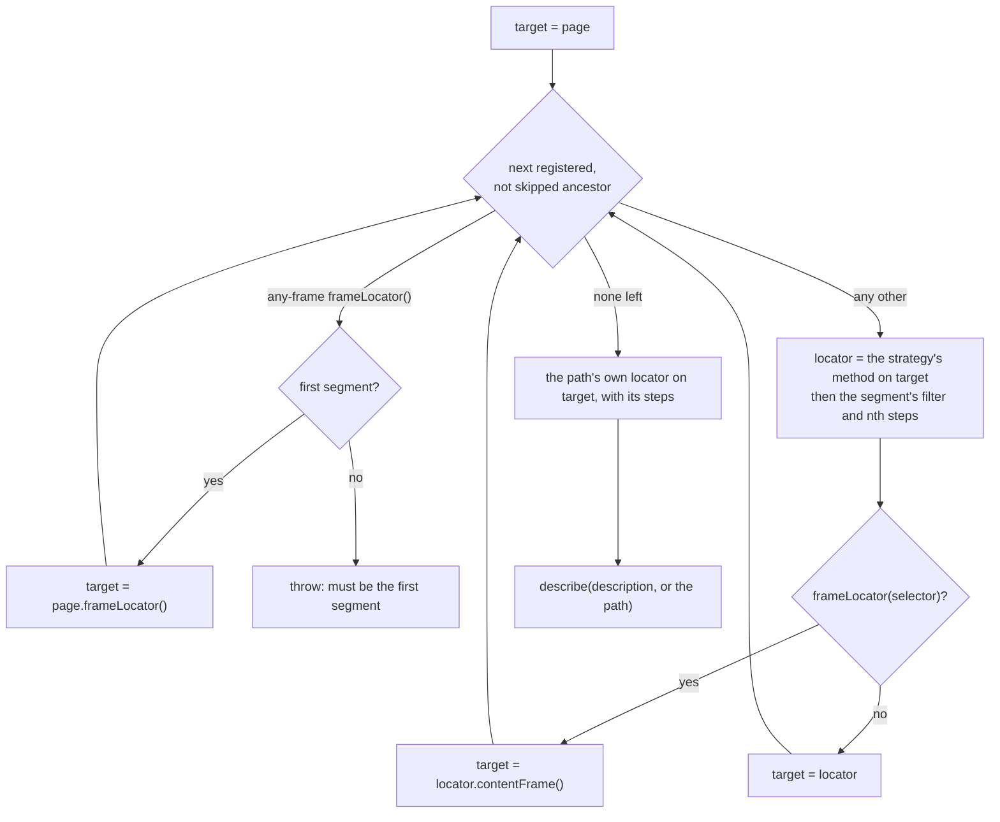

## The chain

Every resolution goes through one method, `buildLocatorChain` in `src/locators/locatorRegistry.ts`. It takes the path,
the path's own definition, the definitions and steps of the segments to include, the segments a query skips, and the
description:

- **Segments.** The ancestors are the path's prefixes (`main` and `main.form` of `main.form.submit`) that have a
  record. An unregistered prefix is a name that groups paths and is left out; with `strictChains`, `verify()` requires
  every one to be registered. A query's `skip` leaves a registered one out for that query.
- **Locators.** Each segment's locator is created on the one before it, by the method the
  [strategy table](/POMWright/internal/strategies-table/) names for its definition: `target.getByRole(role, options)`,
  `target.locator(selector, options)`, and so on.
- **Steps.** A segment's steps follow its locator in the order chained: a filter step calls `locator.filter()`, an
  index step `first()`, `last()` or `nth(index)`.
- **The description.** Only the path's own locator is described, with its description or the path, so the trace
  viewer and the report name the path instead of the chain.

## Filter paths are resolved alone

A `has` or `hasNot` filter may name a registered path. It resolves to that path's own locator with its own steps,
without its ancestors, the resolution `getLocator` gives. Playwright evaluates `has` inside each element being
filtered, so a chain from the page would look for the page's `main` inside a section and match nothing.

A filter path is resolved when the chain that uses it is, so registration accepts forward references: a path may name
one registered later. Each resolution keeps the set of paths it is resolving; a path that is already in the set is a
cycle, and throws instead of recursing without end.

## Frames

A `frameLocator(selector)` segment is resolved as `target.locator(selector)` with its steps: the `<iframe>` element.
The segments after it are created on `locator.contentFrame()`, inside the frame. As the path's own segment it stays the
element, which `has` filters and assertions on the frame need. This is what Playwright recommends since 1.43; it keeps
the steps of a frame segment, which `target.frameLocator(selector)` would have no element to apply to.

`frameLocator()` without a selector is Playwright's `page.frameLocator()`, which exists only at the start of a
selector and has no element. It is accepted only as the first segment of its chain, takes no steps, and cannot be a
path's own segment or a filter path.

## `verify()`

`verify()` resolves every registered path once, terminal-only as `getLocator` does, so every `has` path in the
registry is resolved and every unregistered target and cycle surfaces, without building every chain: an ancestor's
failure would otherwise be reported again under each of its descendants. An any-frame path is checked against the
first-segment rule instead, since it has no terminal form, and `strictChains` adds the check of every ancestor. Every
failure is collected and thrown in one error, with the number of failing paths. It never touches the page; a few
thousand paths take milliseconds.
