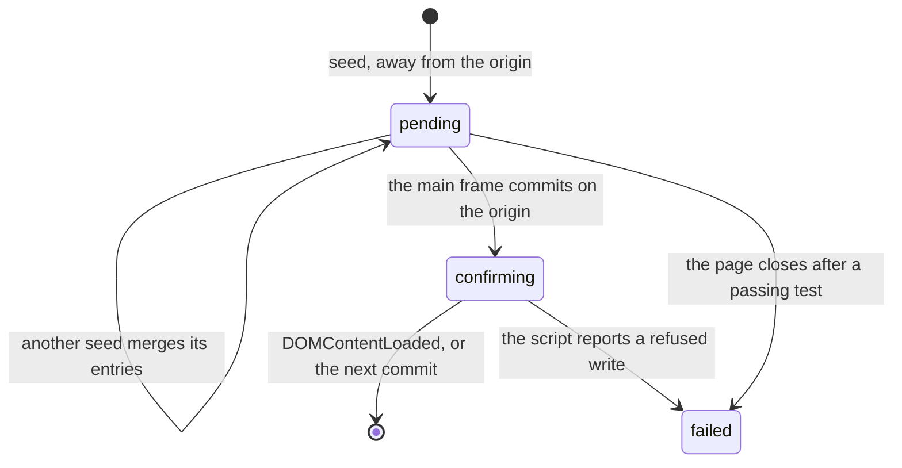
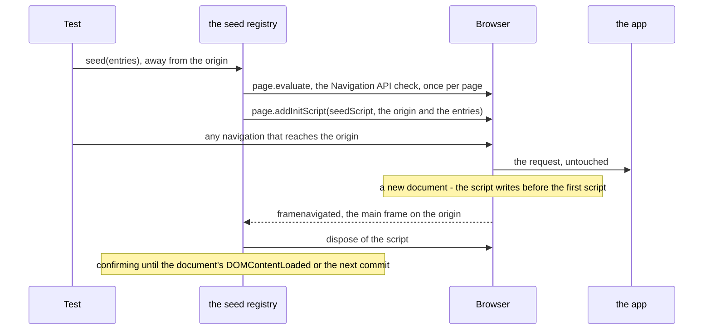

`seed()` stores session storage entries for an origin the page is not on yet, so the app finds them when it starts
there. This page explains how it does that without touching the navigation, and when it fails. How to use it is on
[Seeding session storage](/POMWright/docs/seeding-session-storage/).

## The problem

An app that reads session storage as it starts must find the entries there before its first script runs. Writing
after the load is too late, and writing from a `framenavigated` listener races the app's first script and loses.
Playwright's `addInitScript` runs before the first script of every new document, so it is the place to write, and since
Playwright 1.59 it returns a `Disposable` that removes it. Two things are left to solve: when to remove it, and what it
must not do in the documents that run it before then.

## One registry per page

`SessionStorage.seed()` hands the entries to the page's `SeedRegistry` (`src/helpers/sessionStorageSeed.ts`), created
on first use and kept in a `WeakMap` keyed by the page, so every `SessionStorage` on the page shares it. In the call's
turn, the registry writes the entries at once when the page is on the origin, and otherwise registers them. It keeps
one pending seed per origin; a second `seed` for the same origin registers a script with the merged entries, later
values winning, then disposes of the previous one. Calls for one origin take turns with every session storage call for
that origin on the page, in the order they were made (see
[overlapping calls](/POMWright/internal/seed-registry/#overlapping-calls)).

The first pending seed registers four listeners: `framenavigated`, `domcontentloaded`, `console` and `close`. When
nothing is pending and no applied document can still report a failure, all four are removed: a page that never seeds,
or has applied its seeds, runs exactly as without POMWright.

The seed for one origin goes through these states:

## The script

`seedScript` is a plain function that Playwright serialises, so it refers to nothing outside its body. It runs in every
new document of the page, in every frame, and writes only when all three hold:

- **the main frame**: `window === window.top`, so an iframe on the seeded origin inside another page, and the
  `srcdoc` or `about:blank` frames that inherit its origin, are left alone;
- **the origin**: `location.origin` is the seeded one, and so is the document's own origin, `self.origin`. The error
  page a browser shows for a failed navigation has the URL's origin but an opaque one of its own (Firefox commits it at
  the origin's URL), and so does a sandboxed document;
- **the first arrival**: `navigation.activation.from` is `null`, so the previous document of the main frame was on
  another origin, or there was none.

The third condition is what makes disposal at the commit enough. Disposal reaches the browser a few milliseconds after
the app's first document on the origin commits, up to a few hundred under load. Without the condition, an app whose
first script writes a seeded key and reloads, or moves to another page on the origin, within that time would have the
key overwritten again: about once in a hundred such rounds on every engine. With it, a reload or a hop within the
origin has `activation.from` set and is skipped: no overwrite in 300 rounds per engine.

A write the browser refuses (the storage quota) is caught and logged with `console.error` under a prefix of
POMWright's own, with the origin and the browser's error. A document on the origin's URL that the script skips, an
opaque one or a return, is logged under the same prefix with `console.debug`, so that a test watching the console for
errors is not disturbed.

A skip matters only for the document that took the seed out of pending. After a navigation to the origin that
fails, Chromium and Firefox present the error page's history entry as the next document's `activation.from`, so the
retry looks like a return; Firefox also commits its error page at the origin's URL. Making the retry apply the seed
would mean treating some commits as error pages and accepting that entry as `from`, which rests on browser behaviour
without a guarantee. So the registry does not try: such a seed fails the test, and never passes silently.

## A seeded navigation

- **The commit.** When `framenavigated` reports the main frame on a pending origin, that document has already run the
  script. The registry removes the seed from the pending ones and disposes of its script without waiting for the
  browser's answer.
- **The confirming window.** A refused write reaches Node as a console message after the commit. The script runs
  before the document parses, so the message arrives before that document's `domcontentloaded` and before the next
  main-frame commit, on every engine. Until one of those, the applied seed is kept as confirming. A prefixed message
  for it fails the test from the `console` listener: a refused write, or a skip. Later messages are ignored.

## The checks in `seed`

- **The Navigation API**, once per page, by `page.evaluate` in the current document (which works on `about:blank`):
  without `navigation.activation` the script could not tell a first arrival from a reload, so `seed` throws before
  anything is registered. The check tests the `NavigationActivation` interface, not `navigation.activation`: an app's
  own global `navigation` (`var navigation = …`) shadows the latter in its document, which would make `seed` report a
  browser without the API. The script is not affected, since it runs before the document's first script.
- **A commit during registration.** A temporary `framenavigated` listener watches the main frame from the moment
  `seed` is called until its turn ends, so the wait for earlier calls and the Navigation API check are covered too.
  `seed` also reads whether the page is on the origin at that moment. Both happen before its report step's body runs,
  because Playwright may await work of its own first: with `video: { show: { test } }`, `test.step` updates an overlay
  in every page, a round trip to the browser, and a navigation can commit in that gap. Read inside the body, such a
  commit made the page look as if it had been on the origin all along, and `seed` wrote after the app's first script. If the page commits a document on the origin in that time, it is unknown whether that document ran the
  script: on Chromium, `addInitScript` resolved after such a commit whether or not the document had run it. A call
  that sees the commit before registering throws without registering; one that sees it while `addInitScript` is
  pending disposes of the new script and throws.

## Overlapping calls

A call's turn reads the pending seed, registers a script with the merged entries, stores it as the pending seed and
disposes of the previous script, with two `await`s in between. Each origin has a chain of turns
(`src/helpers/storageTurns.ts`), kept per page and shared by `set`, `get`, `clear` and `seed`: a call joins it
synchronously when it starts, and its turn starts once the previous one has settled, whether it succeeded or failed. So
calls that overlap, in a `Promise.all` or without `await`, end exactly as if each had been awaited in turn, and a call
that fails leaves the pending seed as it was. Chains are per origin, so calls for different origins never wait for each
other.

A `seed` on the origin writes key by key, one round trip each, as `set` does, so two overlapping calls without the
chain would interleave and an earlier value could win. The registry therefore decides in the call's turn, not at the
call, whether to write at once or register: if the page was on the origin at the call and still is, it writes; if it has
left, it registers. A navigation within the origin while the call waits is not an arrival. A call made away from the
origin keeps its commit watch from the call on, so a page that arrives while the call waits fails the call, as before.

Without the chain, two calls that overlap read the same pending seed. Each merges only that seed with its own entries,
so one call's keys are lost; the second stored record replaces the first, whose script stays registered and
untracked; and both dispose of the same previous script, the second time with Playwright's "disposed more than once"
error. The untracked script is the worst of it: since a return from another origin is a first arrival again, it writes
the seeded values after every such return, over what the app has stored. A commit watch that started only at
`addInitScript` would miss a commit during the Navigation API check: a `seed` not awaited before a `goto` on a fresh
page would resolve on Chromium without its entries.

Rejected:

- **A lock taken inside the turn**, after the Navigation API check: it orders the calls by who finished the check
  first, not by the order they were made.
- **Throwing on an overlap**: a `Promise.all` of seeds is a reasonable thing to write.
- **One browser call per `seed` on the origin** (`page.evaluate` writing every entry): it leaves `page.sessionStorage`,
  which the helper mirrors, and still relies on the order of messages rather than a rule. The chain orders every call,
  `set`, `get` and `clear` included.
- **Coalescing**, one registration of everything merged so far: the commit check would no longer belong to the call
  that made it.

## Failures

Every failure carries the line of the `seed` call, captured when it was called (see
[call sites](/POMWright/internal/call-sites/)):

- **No Navigation API** and **a commit during registration** are thrown by the `seed` call itself.
- **A refused write**, and **a seed the arriving document skipped** (an opaque document, or a return), fail the test
  from the `console` listener at once.
- **Never applied.** When the page closes after a test that has passed so far, a seed still waiting fails it, naming
  the origin and the keys.

The listeners do not throw: Playwright's emitter calls a page's listeners in turn, without a `try`, so a throw would
skip the page's later listeners for that event, the test's own included. The error is rethrown from a microtask
instead, which fails the running test at once all the same.

## Limits

- **A popup** is another page, which does not run the page's init scripts, so a hop that opens a new tab leaves the
  seed waiting, and the page's close fails the test. Seeding every page of the context would also seed pages the test
  did not mean to.
- **A quick return.** The first-arrival condition cannot help when the app's first document on the origin writes a
  seeded key, leaves for a document that commits on another origin, and that document sends the browser straight back,
  all before the disposal arrives: the return is a first arrival again. Forced on localhost with a page that bounces
  back as its first script runs, it never happened: no overwrite in 350 rounds per engine, 300 of them with six parallel
  workers.

## Why not a route

An earlier design of 3.0.0, never released, had `seed` answer the navigation with a document of POMWright's own that
wrote the entries and then continued the navigation, through a `page.route`. It was chosen when `addInitScript` could
not be removed. A route sees
only what Playwright intercepts, so it needed a proxy for server redirects, synthesised `Sec-Fetch-*` headers, a
re-submitted form for POSTs (multipart and `text/plain` could not be), a fragment carried over by hand, and a detour so
that WebKit's `goto` waited for the app. Service workers and the test's own mocks bypassed it, and the app saw a
different request than without a seed. An init script runs in whatever document commits, however it was answered, and
leaves the navigation alone.
