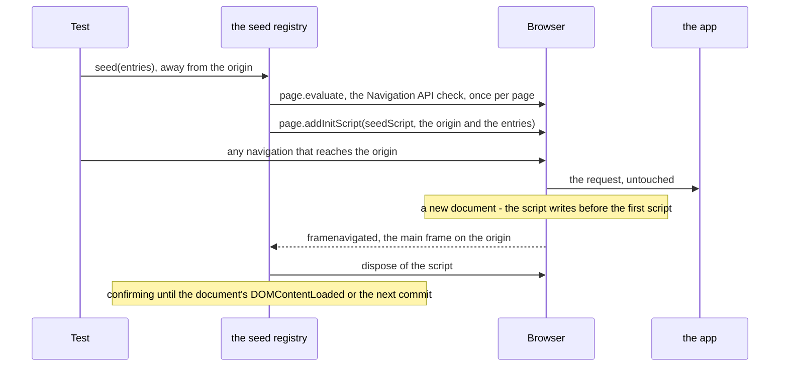

## The problem

An app that reads session storage as it starts must find the entries there before its first script runs. Writing
after the load is too late, and writing from a `framenavigated` listener races the app's first script and loses.
Playwright's `addInitScript` runs before the first script of every new document, so it is the place to write, and since
Playwright 1.59 it returns a `Disposable` that removes it. Two things are left to solve: when to remove it, and what it
must not do in the documents that run it before then.

## One registry per page

`SessionStorage.seed()` writes at once when the page is on the origin. Otherwise it hands the entries to the page's
`SeedRegistry` (`src/helpers/sessionStorageSeed.ts`), created on first use and kept in a `WeakMap` keyed by the page,
so every `SessionStorage` on the page shares it. The registry keeps one pending seed per origin; a second `seed` for the
same origin registers a script with the merged entries, later values winning, then disposes of the previous one.

The first pending seed registers four listeners: `framenavigated`, `domcontentloaded`, `console` and `close`. When
nothing is pending and no applied document can still report a failure, all four are removed: a page that never seeds,
or has applied its seeds, runs exactly as without POMWright.

## The script

`seedScript` is a plain function that Playwright serialises, so it refers to nothing outside its body. It runs in every
new document of the page, in every frame, and writes only when all three hold:

- **the main frame**: `window === window.top`, so an iframe on the seeded origin inside another page, and the
  `srcdoc` or `about:blank` frames that inherit its origin, are left alone;
- **the origin**: `location.origin` is the seeded one;
- **the first arrival**: `navigation.activation.from` is `null`, so the previous document of the main frame was on
  another origin, or there was none.

The third condition is what makes disposal at the commit enough. Disposal reaches the browser a few milliseconds after
the app's first document on the origin commits, up to a few hundred under load. Without the condition, an app whose
first script writes a seeded key and reloads, or moves to another page on the origin, within that time would have the
key overwritten again: about once in a hundred such rounds on every engine. With it, a reload or a hop within the
origin has `activation.from` set and is skipped: no overwrite in 300 rounds per engine.

A write the browser refuses (the storage quota) is caught and logged with `console.error` under a prefix of
POMWright's own, with the origin and the browser's error.

## A seeded navigation

- **The commit.** When `framenavigated` reports the main frame on a pending origin, that document has already run the
  script. The registry removes the seed from the pending ones and disposes of its script without waiting for the
  browser's answer.
- **The confirming window.** A refused write reaches Node as a console message after the commit. The script runs
  before the document parses, so the message arrives before that document's `domcontentloaded` and before the next
  main-frame commit, on every engine. Until one of those, the applied seed is kept as confirming. A prefixed message
  for it throws the failure from the `console` listener. Later messages are ignored.

## The checks in `seed`

- **The Navigation API**, once per page, by `page.evaluate` in the current document (which works on `about:blank`):
  without `navigation.activation` the script could not tell a first arrival from a reload, so `seed` throws before
  anything is registered.
- **A commit during registration.** A temporary `framenavigated` listener watches the main frame while
  `addInitScript` is pending. If the page commits a document on the origin in that time, it is unknown whether that
  document ran the script: on Chromium, `addInitScript` resolved after such a commit whether or not the document had
  run it. The registry disposes of the new script and `seed` throws.

## Failures

Every failure carries the line of the `seed` call, captured when it was called (see
[call sites](/POMWright/internal/call-sites/)):

- **No Navigation API** and **a commit during registration** are thrown by the `seed` call itself.
- **A refused write** is thrown from the `console` listener, which fails the test at once.
- **Never applied.** When the page closes after a test that has passed so far, a seed still waiting throws, naming the
  origin and the keys.

## Limits

- **A popup** is another page, which does not run the page's init scripts, so a hop that opens a new tab leaves the
  seed waiting, and the page's close fails the test. Seeding every page of the context would also seed pages the test
  did not mean to.
- **A quick return.** The first-arrival condition cannot help when the app's first document on the origin writes a
  seeded key, leaves for a document that commits on another origin, and that document sends the browser straight back,
  all before the disposal arrives: the return is a first arrival again. Forced on localhost with a page that bounces
  back as its first script runs, it never happened: no overwrite in 350 rounds per engine, 300 of them with six parallel
  workers.

## Why not a route

Up to plan 15, `seed` answered the navigation with a document of POMWright's own that wrote the entries and then
continued the navigation, through a `page.route`. It was chosen when `addInitScript` could not be removed. A route sees
only what Playwright intercepts, so it needed a proxy for server redirects, synthesised `Sec-Fetch-*` headers, a
re-submitted form for POSTs (multipart and `text/plain` could not be), a fragment carried over by hand, and a detour so
that WebKit's `goto` waited for the app. Service workers and the test's own mocks bypassed it, and the app saw a
different request than without a seed. An init script runs in whatever document commits, however it was answered, and
leaves the navigation alone.
