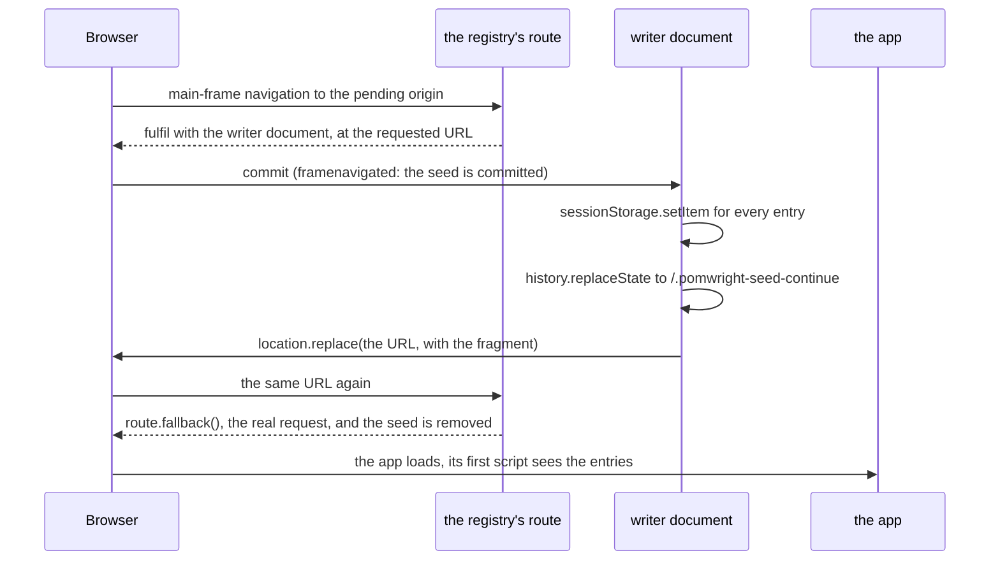

## The problem

An app that reads session storage as it starts must find the entries there before its first script runs. Writing
after the load is too late. Playwright's `addInitScript` runs before every load, cannot be removed, and overwrites what
the app writes on its next load; writing from a `framenavigated` listener races the app's first script and loses.
`seed` instead answers the navigation itself, with a document of POMWright's own that stores the entries and then
continues, so the entries exist before the app's document does.

## One registry per page

`SessionStorage.seed()` writes at once when the page is on the origin. Otherwise it hands the entries to the page's
`SeedRegistry` (`src/helpers/sessionStorageSeed.ts`), created on first use and kept in a `WeakMap` keyed by the page,
so every `SessionStorage` on the page shares it. The registry keeps one pending seed per origin; a second `seed` for the
same origin merges its entries, later values winning.

The first pending seed registers one route for every request and two listeners, `framenavigated` and `close`. When the
last pending seed is applied, all three are removed: a page that never seeds, or has applied its seeds, runs exactly as
without POMWright.

## A seeded navigation

- **The writer document** sets every entry, then continues the navigation: a GET with `location.replace`, a form POST
  by submitting a form with the same fields. A request never carries the URL's fragment, so the document adds its own
  (`#/orders/7`, `#access_token=…`) unless the target has one.
- **The continue path.** From its own URL, a `location.replace` to the same URL with a fragment would only scroll, and
  WebKit's `goto` would not wait for it, so the writer first moves to `/.pomwright-seed-continue` with
  `history.replaceState`, a same-document change without a request.
- **Its own replace** reaches the route again. The registry recognises it, the request to the URL it served while
  committed, lets it through with `route.fallback()`, and removes the seed.

## Navigations to other origins

While a seed waits, a main-frame navigation to another origin may be a server redirect towards the pending one, which
the browser would follow without the route seeing the second hop. So the route fetches such navigations itself with
`route.fetch({ maxRedirects: 0 })`, with the browser's headers and the `Sec-Fetch-*` headers the browser would add. A
redirect is answered with a small redirect document that performs the same navigation from the page, which the route
then sees; any other response is handed back as it is. Requests that are not main-frame navigations always fall
through untouched.

## Failures

Every failure carries the line of the `seed` call, captured when it was called (see
[call sites](/POMWright/internal/call-sites/)):

- **Bypassed.** The `framenavigated` listener sees the main frame commit on a pending origin at a URL the registry did
  not serve: a service worker answered the navigation, or a route the test registered later fulfilled it. The app ran
  without the entries; the listener throws, which fails the test at once, naming the fixes.
- **Not re-issuable.** A `multipart/form-data` or `text/plain` POST cannot be submitted again by a document; the
  registry records the failure and lets the navigation through, and the listener throws it when the app's document
  commits, failing the test.
- **A proxied fetch that fails** aborts that navigation and records the failure, which the next helper call or the
  page's close throws.
- **Never applied.** When the page closes after a test that has passed so far, a seed still waiting throws, naming the
  origin and the keys.

Every `SessionStorage` method first throws a failure the registry has recorded, so it surfaces at the next call.
