## What it does

An honest, evidence-based defect review of any kind of system: a library, a service, a web, desktop or mobile app, a
CLI, a data pipeline, infrastructure code. It is not specific to POMWright. It finds defects, contradictions between
the code, types, tests, docs and configuration, design decisions whose cost it can show, and gaps in tests, docs and
operations. It reproduces every finding before it reports it, gives each its severity and the impact of its fix, and
changes nothing: the report is the product.

## When to use it

It starts only when you run it: `/defect-review` in Claude Code, `$defect-review` in Codex. A review takes one of
three scopes:

- the whole project: "a pre-release review of this repository";
- a change set: "review this branch", "what changed since v1.2", a pull request;
- one area: "review the invoice export", `src/auth/`.

When the request does not say which, it asks.

## How it works

1. **Orient and profile.** It reads the project's contributor guide, README and manifests, and writes a profile of the
   system before forming any opinion: what kind of system it is, its contracts, the environments it supports, the
   standards it follows, and its risks. The report states the profile.
2. **Map.** It lists everything in scope (interfaces, contracts, messages, configuration, docs, tests) and splits the
   list into segments ordered by risk. It asks who runs the segments (the agent one at a time, in parallel, or you, one
   session each) and whether to cap their cost.
3. **Review.** Each segment probes its contracts at their edges, in the environment the behavior lives in, and only in
   environments the reviewer controls, never production or shared systems.
4. **Report.** One Markdown file: the confirmed defects with their reproductions, documentation findings, what it could
   not confirm, design questions, and what it found sound.

## What was measured

Built while reviewing POMWright itself, first for POMWright and then made general. Evaluated with and without the skill
on Claude Opus 5.5: a whole small library, a release's change set, one area and an ambiguous request.

| measure | with | without |
| --- | --- | --- |
| known defects found, each reproduced | **88%** | 38% |
| all checks passed | **96%** | 42% |
| asked for the scope when it was unclear | **yes** | no |

```mermaid
%%{init: {"themeVariables": {"xyChart": {"plotColorPalette": "#3b82f6, #f97316"}}}}%%
xychart-beta
  title "Share, %"
  x-axis ["known defects found", "checks passed"]
  y-axis "%" 0 --> 100
  bar [88, 96]
  bar [38, 42]
```

Blue: with the skill. Orange: without it.

In use, its reviews found most of the defects fixed in POMWright 3.0.1 and 3.0.2, each with its reproduction:

| whole-project review of 3.0.2 | confirmed defects | documentation findings |
| --- | --- | --- |
| first | 30 (6 medium, 24 low) | 19 |
| second, after the fixes | 19 (3 medium, 16 low) | 37 |

They also caught release blockers before a merge, such as a dependency update that would have failed every publish.
Run it as the [index](/POMWright/skills/#using-them-well) recommends.

## Install and source

Install it as the [index](/POMWright/skills/#install) shows, on its own or with the POMWright skills. Source:
[`skills/defect-review`](https://github.com/DyHex/POMWright/tree/main/skills/defect-review).
