## What it does

From a running site to page code your tests can use. You name the origin and pick the pages; the agent reads each page
as a user meets it, designs its locator paths, generates the files, and checks every path against the live page. It
only reads and reveals: it clicks only what you confirmed, to open menus, tabs and the like, never types or submits,
and aborts every request but `GET` and `HEAD` while it maps. It opens pages only on the origins you named, and checks
where a redirect leads before following it.

## When to use it

It starts when you ask an agent to generate page objects, locators or a test project for a site, or to start a
POMWright suite from an existing application. For example:

- "Generate page objects for the checkout of https://shop.example."
- "Map the account pages of the staging site for POMWright."

It builds on the [`pomwright`](/POMWright/skills/pomwright/) skill, which must be installed too.

## How it works

1. **Scope.** It asks in one message: the origin and start path, the environment, whether pages need a login (a
   Playwright `storageState` file you saved), what tests should check beyond the elements a user acts on, and whether
   the app's source is available. Without a `POMWRIGHT.md`, the `pomwright` skill's questions come in the same message.
2. **Crawl.** It lists the pages on the origin, grouped by path pattern; you pick the pages.
3. **Read.** For each page it reads the accessibility snapshot, the DOM and a screenshot, and reveals what a user can
   open, with your agreement.
4. **Design and generate.** It registers the parts several pages share once, in common modules, and writes the origin
   in `env.ts`, then per page a locator module, its page code and its fixture, by your `POMWRIGHT.md`.
5. **Verify and report.** It compiles the code and runs a starter test per page that checks every path, fixes a path
   that matches nothing or too much, and reports what it generated, what it left out and why, and the accessibility
   gaps it saw.

It works with Playwright alone, through a script it ships, and maps with that script. Where your machine has
`playwright-cli` or Playwright MCP, it asks before using one for a state the script cannot reach.

## What was measured

A real site's start page and product page, mapped into page code in an empty project (Playwright, POMWright and
TypeScript installed, nothing else) with the web open: 8 runs with the skills and 4 without, 2 a setup. Claude Opus 5.5
at effort high, graded by code against a reviewed reference mapping on the live site.

| measure | with the skills (8 runs) | without (4 runs) | gain |
| --- | --- | --- | --- |
| compiles, its tests pass on the site, no path that matches nothing | **8 of 8** | 4 of 4 | |
| the reference's paths mapped | **88%** | 88% | the same |
| cost per run | **$3.90** | $6.06 | 36% cheaper |
| time per run | **10.9 min** | 16.8 min | 35% faster |
| singular paths that match several, in all | **0** | 26 | |
| picks by position (`nth`, `first`, `last`), in all | **0** | 5 | |
| locators by CSS | **3%** | 18% | |

```mermaid
%%{init: {"themeVariables": {"xyChart": {"plotColorPalette": "#f97316, #3b82f6"}}}}%%
xychart-beta
  title "Per run"
  x-axis ["minutes", "dollars"]
  y-axis 0 --> 18
  bar [16.8, 6.06]
  bar [10.9, 3.90]
```

Blue: with the skills. Orange: without them. A singular path that matches several elements fails when a test acts on
it; the skill's starter test checks every path's count, so its code has none.

| setup | runs | cost per run | time per run | reference mapped |
| --- | --- | --- | --- | --- |
| skills, Playwright's library | 2 | **$3.39** | 9.6 min | 85% |
| skills, library and CLI | 2 | $3.83 | 12.4 min | **93%** |
| skills, library and MCP | 2 | $3.76 | **9.2 min** | 85% |
| skills, library, CLI and MCP | 2 | $4.60 | 12.2 min | 90% |
| no skills, library | 2 | $6.96 | 20.2 min | 86% |
| no skills, MCP | 2 | $5.17 | 13.3 min | 91% |

- **Its own script**: every setup with the skills cost less and took less time than either setup without them. Given
  Playwright MCP, the skills still mapped with their script; without the skills, MCP cost 53% more and took 39% longer
  than the skills with the library alone.
- **Effort high**, as the [index](/POMWright/skills/#using-them-well) recommends.

## Install and source

Install it with `pomwright`, as the [index](/POMWright/skills/#install) shows. Source:
[`skills/pomwright-map-site`](https://github.com/DyHex/POMWright/tree/main/skills/pomwright-map-site).
