## What it does

From a running site to page code your tests can use. You name the origin and pick the pages; the agent reads each page
as a user meets it, designs its locator paths, generates the files, and checks every path against the live page. It
only reads and reveals: it clicks only what you confirmed, to open menus, tabs and the like, never types or submits,
and aborts every request but `GET` and `HEAD` while it maps.

## When to use it

It starts when you ask an agent to generate page objects, locators or a test project for a site, or to start a
POMWright suite from an existing application. For example:

- "Generate page objects for the checkout of https://shop.example."
- "Map the account pages of our staging site for POMWright."

It builds on the [`pomwright`](/POMWright/skills/pomwright/) skill, which must be installed too.

## How it works

1. **Scope.** It asks in one message: the origin and start path, the environment, whether pages need a login (a
   Playwright `storageState` file you saved), what tests should check beyond the elements a user acts on, and whether
   the app's source is available. Without a `POMWRIGHT.md`, the `pomwright` skill's questions come in the same message.
2. **Crawl.** It lists the pages on the origin, grouped by path pattern; you pick the pages.
3. **Read.** For each page it reads the accessibility snapshot, the DOM and a screenshot, and reveals what a user can
   open, with your agreement.
4. **Design and generate.** It registers the parts several pages share once, in common modules, and writes the origin
   in `env.ts`, then per page a locator module, its page code and its fixture, by your `POMWRIGHT.md`.
5. **Verify and report.** It compiles the code and runs a starter test per page that checks every path, fixes a path
   that matches nothing or too much, and reports what it generated, what it left out and why, and the accessibility
   gaps it saw.

It works with Playwright alone, through a script it ships, and maps with that script. Where your machine has
`playwright-cli` or Playwright MCP, it asks before using one for a state the script cannot reach.

## What was measured

A real site's start page and product page, mapped into page code with the skill and without it, Claude Opus 5.5 at
effort high, and graded against a reviewed reference mapping.

| measure | with | without | gain |
| --- | --- | --- | --- |
| compiles, tests pass on the site | **100%** | 100% | |
| paths that match nothing | **0** | 0 | |
| the reference's paths mapped | **90%** | 92% | the same |
| time per run | **10.8 min** | 16.9 min | 36% faster |
| cost per run | **$4.57** | $6.12 | 25% cheaper |

```mermaid
%%{init: {"themeVariables": {"xyChart": {"plotColorPalette": "#f97316, #3b82f6"}}}}%%
xychart-beta
  title "Per run"
  x-axis ["minutes", "dollars"]
  y-axis 0 --> 18
  bar [16.9, 6.12]
  bar [10.8, 4.57]
```

Blue: with the skill. Orange: without it.

- **Its own script**: runs that mapped with Playwright MCP instead took 32% longer and cost 36% more, and mapped no more
  of the page. The skill maps with its script, and uses Playwright's tools only for what the script cannot reach.
- **Effort high**, as the [index](/POMWright/skills/#using-them-well) recommends.

## Install and source

Install it with `pomwright`, as the [index](/POMWright/skills/#install) shows. Source:
[`skills/pomwright-map-site`](https://github.com/DyHex/POMWright/tree/main/skills/pomwright-map-site).
