## What it does

It teaches an agent POMWright: page objects (`PageObject`, or your project's own classes, functions or fixtures over a
registry), locator paths and locator modules, fixtures and test data, navigation, session storage, the `log` fixture
and `@step`. With it the agent writes, reviews, refactors and upgrades tests and page code the way these docs
recommend, and leaves to Playwright everything Playwright owns. Exact signatures and messages come from the
declarations of the POMWright version you installed, not from the agent's memory.

## When to use it

It starts by itself whenever code imports from `pomwright`, a project has a `POMWRIGHT.md`, or you mention
POMWright. For example:

- "Write a page object for the orders page, and a test that cancels an open order."
- "Review the page objects in `tests/` and list what to change."
- "Upgrade this project from POMWright 2.x."

## How it works

1. **The installed versions.** It reads the versions of `pomwright` and `@playwright/test` in `node_modules`. A 2.x
   project is upgraded as a task of its own, and a `@playwright/test` outside the range POMWright supports is pointed
   out before anything changes; its upgrade is your call.
2. **The project's `POMWRIGHT.md`.** It looks for the file beside the Playwright config and in the folders above it,
   and follows it: its decisions replace the skill's defaults. When it is missing, writing it is the first task: the
   skill asks every decision in one message, with what the project does now beside each default, and writes no code
   until you answer. It then offers a line pointing to the file in your agent instructions (`AGENTS.md`, `CLAUDE.md`).
3. **The task**, by the skill's rules and the guide for it: choosing locators and paths, writing page objects, locator
   modules, tests, fixtures and test data, the structure of a project, a review, an upgrade.

`POMWRIGHT.md` records the project's decisions:

- **Which parts of POMWright it uses**: `PageObject`, a registry of its own, `@step`, `SessionStorage`, the `log`
  fixture. The skill uses no other.
- **The project**: its apps and origins, Playwright's `baseURL`, the layout and file names, the shape of the page code,
  where checks live, test data, and the model and effort to use for which task.
- **How paths are named**: by default a segment names what the element does and which one in a user's words
  (`main.form@login.button@login`), plural for several (`main.table@orders.rows`), and a region is a `section` whatever
  it looks like. A project that names them another way records its own convention, and the skill follows it.

The defaults are in the skill's
[template](https://github.com/DyHex/POMWright/blob/main/skills/pomwright/assets/templates/POMWRIGHT.md).

## What was measured

144 runs on 24 tasks against a practice shop: page objects and tests, flaky tests, seeded session storage, upgrades
from 2.x, reviews and new projects, 3 runs a task with the skill and 3 without. Each run started in a fresh sandbox
with the web and the project's code, but no notes on its conventions; Claude Opus 5.5 at effort high. A run is fully
correct when its code compiles, its tests pass and a reviewer finds the task done.

| measure | with the skill | without | gain |
| --- | --- | --- | --- |
| fully correct | **71 of 72 (99%)** | 52 of 72 (72%) | +27 points |
| code compiles, its tests pass | 54 of 54 | 54 of 54 | |
| mistakes a reviewer would flag, per run | **0.03** | 0.29 | 90% fewer |
| asked the open decisions first | **9 of 9** | 0 of 9 | |
| reviews that found every planted problem | **6 of 6** | 4 of 6 | |
| cost, time per correct result | **$0.51, 68 s** | $0.67, 91 s | 23% cheaper, 25% faster |
| cost, time per run | $0.50, 67 s | $0.48, 65 s | 5% dearer, 2% slower |
| reviews of a whole project | | | **38% cheaper, 38% faster** |

```mermaid
%%{init: {"themeVariables": {"xyChart": {"plotColorPalette": "#3b82f6, #f97316"}}}}%%
xychart-beta
  title "Share of runs, %"
  x-axis ["fully correct", "asked first", "found every problem"]
  y-axis "%" 0 --> 100
  bar [99, 100, 100]
  bar [72, 0, 67]
```

Blue: with the skill. Orange: without it. Per correct result, because a wrong result is work to redo:

| per correct result, by kind of task | with the skill | without | gain |
| --- | --- | --- | --- |
| reviews of a whole project (6 of 6 correct, both) | **$0.68, 116 s** | $1.09, 186 s | 38% cheaper, 38% faster |
| asking the open decisions (9 of 9, 0 of 9) | **$0.34, 35 s** | no correct result | |
| writing page code and tests (44 of 45, 34 of 45) | **$0.50, 69 s** | $0.52, 73 s | 4% cheaper, 6% faster |
| upgrades from 2.x (9 of 9, both) | $0.74, 82 s | $0.67, 65 s | 11% dearer, 26% slower |

What failed without the skill:

- 9 of 9 runs of the tasks that start with open decisions wrote code instead of asking.
- 9 runs registered `main` by CSS, `locator("main")`, where Playwright recommends its role, `getByRole("main")`; 4 of
  them registered it again in each page.
- 2 runs checked a count read once with a plain `expect`, not a web-first assertion (1 run with the skill).

Also measured:

- **Larger tasks**, such as refactoring a whole test project, were not measured. Every file a task touches is one more
  chance for the mistakes above, and the largest task measured, a review of a whole project, gained the most.
- **Effort high**: in the effort test, low took 14 minutes and $3.28 for what high did in 4 seconds, and medium gave no
  answer ([using them well](/POMWright/skills/#using-them-well)).

## Install and source

Install it as the [index](/POMWright/skills/#install) shows. Source:
[`skills/pomwright`](https://github.com/DyHex/POMWright/tree/main/skills/pomwright).
