## What it does

It teaches an agent POMWright: page objects (`PageObject`, or your project's own classes, functions or fixtures over a
registry), locator paths and locator modules, fixtures and test data, navigation, session storage, the `log` fixture
and `@step`. With it the agent writes, reviews, refactors and upgrades tests and page code the way these docs
recommend, and leaves to Playwright everything Playwright owns. Exact signatures and messages come from the
declarations of the POMWright version you installed, not from the agent's memory.

## When to use it

It starts by itself whenever code imports from `pomwright`, a project has a `POMWRIGHT.md`, or you mention
POMWright. For example:

- "Write a page object for the orders page, and a test that cancels an open order."
- "Review the page objects in `tests/` and tell me what to change."
- "Upgrade this project from POMWright 2.x."

## How it works

1. **The installed versions.** It reads the versions of `pomwright` and `@playwright/test` in `node_modules`. In a 2.x
   project it says so before changing anything: the upgrade is a task of its own; and so it does for a
   `@playwright/test` outside the range POMWright supports, whose upgrade is your call.
2. **The project's `POMWRIGHT.md`.** It looks for the file beside the Playwright config and in the folders above it,
   and follows it: its decisions replace the skill's defaults. When it is missing, writing it is the first task: the
   skill asks every decision in one message, with what the project does now beside each default, and writes no code
   until you answer. It then offers a line pointing to the file in your agent instructions (`AGENTS.md`, `CLAUDE.md`).
3. **The task**, by the skill's rules and the guide for it: choosing locators and paths, writing page objects, locator
   modules, tests, fixtures and test data, the structure of a project, a review, an upgrade.

`POMWRIGHT.md` records the project's decisions: which parts of POMWright it uses (`PageObject`, a registry of its own,
`@step`, `SessionStorage`, the `log` fixture), and the skill uses no other; its apps and origins, Playwright's
`baseURL`, the layout and file names, the shape of the page code, how paths are named, where checks live, test data, and
the model and effort to use for which task. The skill's default names a path segment by what the element does and which
one in a user's words (`main.form@login.button@login`), plural for several (`main.table@orders.rows`), a region a
`section` whatever it looks like; a project that names them another way records its own convention, and the skill
follows it. The defaults are in the skill's
[template](https://github.com/DyHex/POMWright/blob/main/skills/pomwright/assets/templates/POMWRIGHT.md).

## What was measured

Over 600 runs with and without the skill, on 25 tasks against a practice shop: page objects and tests, flaky tests,
seeded session storage, upgrades from 2.x, reviews and new projects. The first rounds ran Claude Haiku, Sonnet and
Opus; the finished skill was measured on Claude Opus 5.5 at effort high.

| measure | with | without | gain |
| --- | --- | --- | --- |
| fully correct | **100%** | 71% | +29 points |
| mistakes per run | **0.17** | 0.55 | 69% fewer |
| asked the open decisions first | **100%** | 0% | |
| reviews that found every problem | **92%** | 17% | |
| time per run | **59 s** | 65 s | 8% faster |
| cost per run | **$0.49** | $0.50 | the same |
| larger tasks | | | **18–38% faster, 19–31% cheaper** |

```mermaid
%%{init: {"themeVariables": {"xyChart": {"plotColorPalette": "#3b82f6, #f97316"}}}}%%
xychart-beta
  title "Share of runs, %"
  x-axis ["fully correct", "asked first", "found every problem"]
  y-axis "%" 0 --> 100
  bar [100, 100, 92]
  bar [71, 0, 17]
```

Blue: with the skill. Orange: without it. A mistake is what a reviewer would flag; a review found every problem when
it named each one planted in the project.

| model, first rounds | passing every check, with the skill |
| --- | --- |
| Claude Haiku | 54% |
| Claude Sonnet | 79% |
| Claude Opus | **88%** |

- **Larger tasks**, such as refactoring a whole test project, gain the most: the skill keeps structure, names, reuse
  and decisions consistent, and every file a task touches is one more chance to.
- **Effort high**: in the effort test, low took 14 minutes and $3.28 for what high did in 4 seconds, and medium gave no
  answer ([using them well](/POMWright/skills/#using-them-well)).

## Install and source

Install it as the [index](/POMWright/skills/#install) shows. Source:
[`skills/pomwright`](https://github.com/DyHex/POMWright/tree/main/skills/pomwright).
